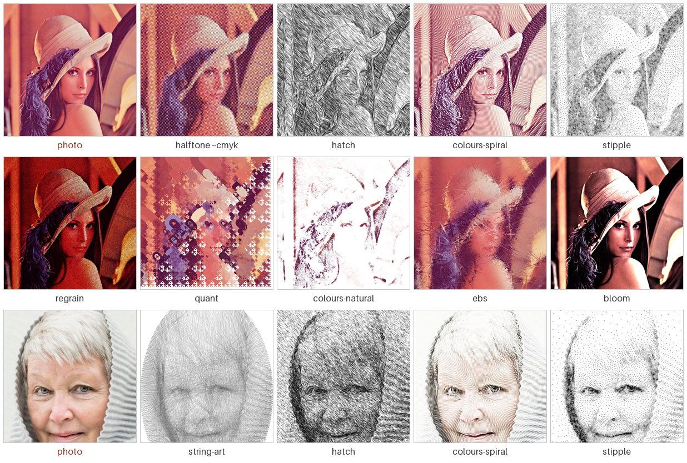
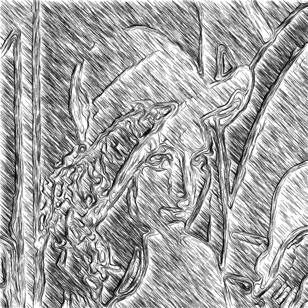

# effekt

Generative image effects rendered with cairo. Each effect reads a reference
image and writes a PNG.



| Effect            | What it does                                                              | Origin   |
| ----------------- | ------------------------------------------------------------------------- | -------- |
| `bloom`           | Every pixel emits an additive disc sized by its brightness.               | Original |
| `regrain`         | Rebuilds the image from random red, green and blue film grains.           | Original |
| `colours-natural` | A pen wanders over the image, steered by the bytes of a file.             | Original |
| `ebs`             | Swarms of entities flock across the image and leave coloured trails.      | Original |
| `quant`           | Subdivides the image wherever it has detail and strokes each cell.        | Original |
| `colours-spiral`  | One line spirals out from the centre, thicker where the image is darker.  | Claude   |
| `halftone`        | A grid of dots, each sized by how dark the image is beneath it.           | Claude   |
| `hatch`           | Short pen strokes follow the image's contours, denser where it is darker. | Claude   |
| `stipple`         | Evenly spaced dots, packed closer together where the image is darker.     | Claude   |
| `string-art`      | One thread wound between pins around the edge until the picture appears.  | Claude   |

**Original** effects are ports of Lasse Nielsen's 2011 Python 2 scripts (see
[History and Source](#history-and-source)). **Claude** effects were written new
for this repo by [Claude](https://claude.com/claude-code), Anthropic's AI model.
`colours-spiral` borrows the name of an original script of which only a
fragment survives; the effect itself is new.

## Tutorial

[**Drawing pictures with Python**](docs/tutorial/README.md) is a step-by-step
tutorial on writing effects like these yourself. It is for people who know some
Python and have never drawn with it, and it needs no knowledge of cairo, Pillow
or NumPy.

| Start with a circle | Build a halftone | Finish with a hatch |
| --- | --- | --- |
|  |  |  |

Nine short pages go from an empty file to two working effects, then tour how
this project is put together. Every script in it is a real file you can run.

## Install

Requires Python 3.12+, [uv](https://docs.astral.sh/uv/) and the cairo development
files (`libcairo2-dev` on Debian/Ubuntu, `brew install cairo pkg-config` on macOS).

To work on the code, or to run it from a checkout with `uv run effekt`:

```sh
uv sync
```

To install the `effekt` command for your user (uv puts it in `~/.local/bin`):

```sh
uv tool install .                      # from a checkout
uv tool install git+https://github.com/ryant71/effekt   # or straight from GitHub
```

If `effekt` is not found afterwards, run `uv tool update-shell` to add that
directory to your `PATH`. After pulling new changes, reinstall with
`uv tool install --reinstall .`; `uv tool uninstall effekt` removes it. With the
command installed, drop the `uv run` prefix from the examples below.

### Shell completion

`effekt --print-completion <shell>` prints a completion script for `bash`,
`zsh`, `tcsh`, `fish` or `powershell`. It completes effect names, options and
file arguments. Regenerate the script after upgrading, since it is a snapshot of
the options at the time it was written.

```sh
# zsh: any directory on $fpath works; add the fpath line to ~/.zshrc before compinit
mkdir -p ~/.local/share/zsh_completion
effekt --print-completion zsh > ~/.local/share/zsh_completion/_effekt
fpath=(~/.local/share/zsh_completion $fpath)

# bash
mkdir -p ~/.local/share/bash-completion/completions
effekt --print-completion bash > ~/.local/share/bash-completion/completions/effekt

# fish
effekt --print-completion fish > ~/.config/fish/completions/effekt.fish
```

## Usage

```sh
uv run effekt bloom photo.png out.png
uv run effekt regrain photo.png out.png --seed 1
uv run effekt colours-natural strokes.bin photo.png out.png
uv run effekt colours-spiral photo.png out.png
uv run effekt ebs photo.png out.png 5000
uv run effekt halftone photo.png out.png --cmyk
uv run effekt hatch photo.png out.png --seed 1
uv run effekt quant photo.png out.png
uv run effekt stipple photo.png out.png --seed 1
uv run effekt string-art photo.png out.png
```

`strokes.bin` can be any file; `colours-natural` draws one stroke per byte.
Every effect has tuning options, listed by `uv run effekt <effect> --help`.
[docs/examples.md](docs/examples.md) shows what each effect and option does to
a test image.

The effects are also importable:

```python
from pathlib import Path

from effekt import Reference, quant

surface = quant.render(Reference.load(Path("photo.png")))
surface.write_to_png("out.png")
```

## Development

```sh
uv run pytest
uv run ruff check
uv run ruff format
```

## Licence

[CC BY-NC 3.0](http://www.creativecommons.org/licenses/by-nc/3.0/), the licence
the original scripts carried, kept for the whole project. See
[History and Source](#history-and-source) for where the code came from.

## History and Source

The five original effects (`bloom`, `regrain`, `colours-natural`, `ebs` and
`quant`) were written by Lasse Nielsen. Each script carried this header:

```text
Copyright Lasse Nielsen 2011 (CC-BY-NC, http://www.creativecommons.org/licenses/by-nc/3.0/)
Web: http://www.effekts.dk
```

That website no longer exists. I found the scripts many years ago in a Reddit post if I recall correctly. The only
other trace of the name I have come across is an artist page from 2003 on the
Pixelache festival's site:
<https://www.juhuu.nu/pixelache/2003/hki/artists.php?name=effekt>.

This repo exists so that the work is not lost:

- **2011** (or even before then): the scripts are written, in Python 2.
- **2020**: I put my copies in this repo after finding them in a backup drive (I'm a hoarder.)
- **2026**: with [Claude](https://claude.com/claude-code), the five scripts are
  ported to Python 3 and turned into an installable package with tests. The
  ports draw what the originals drew; the two places where they differ are
  recorded in [pull request #1](https://github.com/ryant71/effekt/pull/1). The
  authorship headers are kept at the top of each ported file.
- **2026**: Claude adds five new effects and the tutorial. They are marked in
  the table at the top of this page and are not Lasse Nielsen's work.

A sixth original script, `colours_spiral`, survives only as its last 50 lines,
which is too little to port. The fragment is kept in
[`tmp/colours_spiral.py`](tmp/colours_spiral.py).

I make no claim to the original code. If you are Lasse Nielsen, or know him,
please get in touch: I would be glad to credit this properly, transfer the repo
or take it down, whichever you prefer.
