# Examples

What each effect does and how its options change the result. Every example shows the input image, the command, and what the command produced.

The results are reduced to fit the page, and transparent areas are shown as white. The real size of each output is given above it. Commands assume `effekt` is installed; from a checkout, put `uv run` in front.

This page and its images are generated by `uv run python docs/make_examples.py`.

- [bloom](#bloom)
- [regrain](#regrain)
- [colours-natural](#colours-natural)
- [colours-spiral](#colours-spiral)
- [ebs](#ebs)
- [halftone](#halftone)
- [hatch](#hatch)
- [quant](#quant)
- [stipple](#stipple)
- [string-art](#string-art)

## bloom

Every output pixel emits an additive disc of light. Brighter pixels emit bigger discs, so light areas spread and burn out.

### Defaults

`--exposure 10` on a canvas twice the size of the input (`--scale 2`). Each pixel's disc reaches up to 10 pixels, so all but the darkest areas clip to white.

```sh
effekt bloom test-images/lena-test.png out.png
```

| Input | Output (1024x1024) |
| --- | --- |
|  |  |

### `--exposure 3`

Overall brightness follows the exposure. At 3 the highlights still clip but the midtones come back.

```sh
effekt bloom test-images/lena-test.png out.png --exposure 3
```

| Input | Output (1024x1024) |
| --- | --- |
|  | 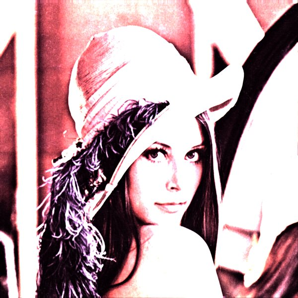 |

### `--exposure 1`

Close to the source, with harder contrast and a slight glow around highlights.

```sh
effekt bloom test-images/lena-test.png out.png --exposure 1
```

| Input | Output (1024x1024) |
| --- | --- |
|  | 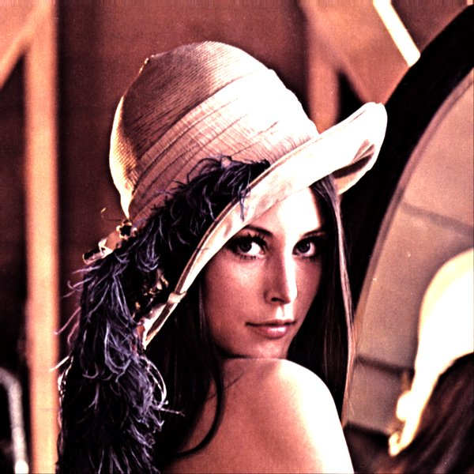 |

### `--exposure 0.5`

Underexposed: only the brightest areas register.

```sh
effekt bloom test-images/lena-test.png out.png --exposure 0.5
```

| Input | Output (1024x1024) |
| --- | --- |
|  |  |

### `--min-exposure 1.5`

`--min-exposure` is a floor on the disc radius. Set above the exposure, it makes every pixel emit a full-size disc, which washes the picture out.

```sh
effekt bloom test-images/lena-test.png out.png --exposure 1 --min-exposure 1.5
```

| Input | Output (1024x1024) |
| --- | --- |
|  |  |

### A bright portrait at its own size

`--scale 1` keeps the output the size of the input. A low exposure holds the detail of a light photo, at the cost of a dim, grey result.

```sh
effekt bloom test-images/lena-old.jpg out.png --scale 1 --exposure 0.5
```

| Input | Output (1000x1500) |
| --- | --- |
| 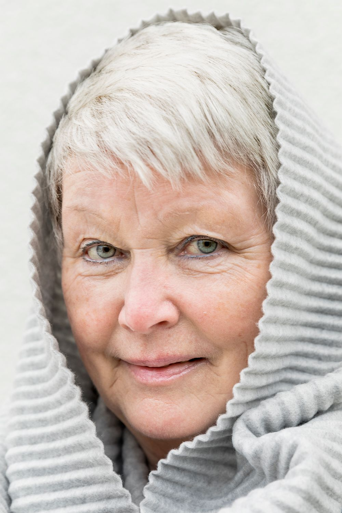 | 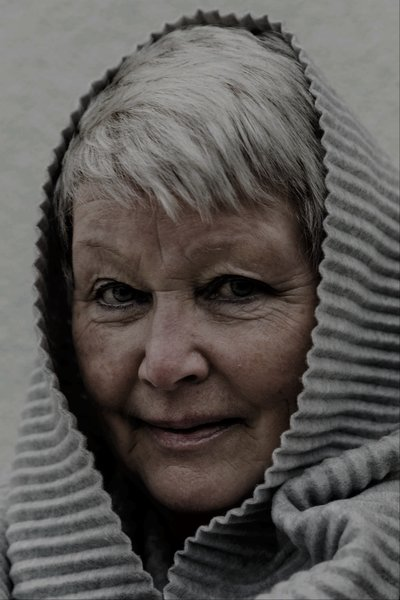 |

## regrain

Rebuilds the image from randomly placed red, green and blue grains, like the dye clouds of colour film. The examples pass `--seed` so they can be reproduced; without it every run is different.

### Defaults

A canvas four times the size of the input, one sample per output pixel. The grain is fine at this size and the colours shift towards red.

```sh
effekt regrain test-images/lena-test.png out.png --seed 1
```

| Input | Output (2048x2048) |
| --- | --- |
|  |  |

### `--grain 2`

Bigger grains overlap more, so the picture gets brighter and flatter.

```sh
effekt regrain test-images/lena-test.png out.png --seed 1 --grain 2
```

| Input | Output (2048x2048) |
| --- | --- |
|  |  |

### `--grain 0.3`

Small grains leave most of the black canvas uncovered.

```sh
effekt regrain test-images/lena-test.png out.png --seed 1 --grain 0.3
```

| Input | Output (2048x2048) |
| --- | --- |
|  |  |

### `--iso 0.2`

`--iso` is how much light each grain holds. Lower values darken the picture without changing the grain size.

```sh
effekt regrain test-images/lena-test.png out.png --seed 1 --iso 0.2
```

| Input | Output (2048x2048) |
| --- | --- |
|  |  |

### `--exposure 0.25`

A quarter of the samples: darker, more speckled, and four times quicker to render.

```sh
effekt regrain test-images/lena-test.png out.png --seed 1 --exposure 0.25
```

| Input | Output (2048x2048) |
| --- | --- |
|  | 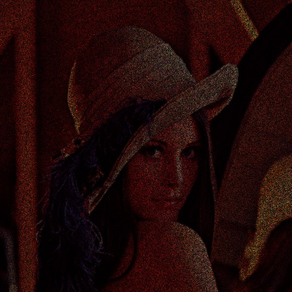 |

### Coarse grain with `--scale 1`

Grain size is measured in output pixels, so on a canvas the size of the input the grains are four times coarser relative to the picture.

```sh
effekt regrain test-images/lena-old.jpg out.png --seed 1 --scale 1
```

| Input | Output (1000x1500) |
| --- | --- |
|  |  |

## colours-natural

A pen wanders over the canvas, pulled towards darker areas, and strokes in the colour underneath. The first argument is a file of stroke data: any file works, and each byte steers one stroke, so a bigger file means more strokes. Here the image file doubles as its own stroke data. The background stays transparent.

### Defaults

473,831 strokes on a canvas four times the size of the input. Strokes are widest where the image changes fastest, so edges come out and flat areas stay empty.

```sh
effekt colours-natural test-images/lena-test.png test-images/lena-test.png out.png
```

| Input | Output (2048x2048) |
| --- | --- |
|  | 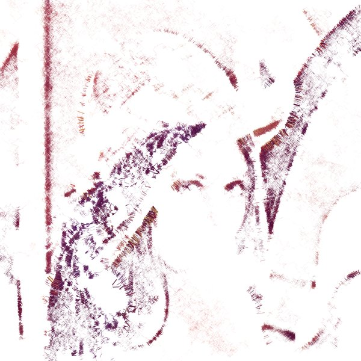 |

### `--island 400`

The pen jumps to a new random spot every 400 steps instead of every 4000, which spreads the strokes more evenly.

```sh
effekt colours-natural test-images/lena-test.png test-images/lena-test.png out.png --island 400
```

| Input | Output (2048x2048) |
| --- | --- |
|  | 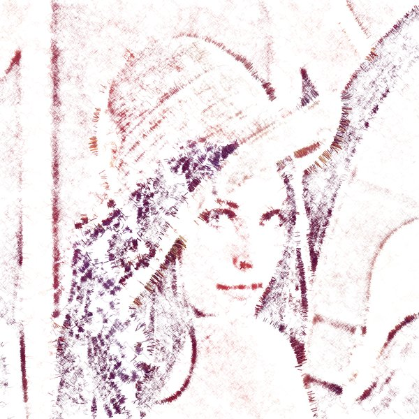 |

### `--damp 0.6`

The pen keeps more of its speed between strokes, so it travels further and the marks become longer and looser.

```sh
effekt colours-natural test-images/lena-test.png test-images/lena-test.png out.png --damp 0.6
```

| Input | Output (2048x2048) |
| --- | --- |
|  |  |

### `--scale 1`

On a canvas the size of the input the strokes are thinner and cover much less.

```sh
effekt colours-natural test-images/lena-test.png test-images/lena-test.png out.png --scale 1
```

| Input | Output (512x512) |
| --- | --- |
|  |  |

### A bright, low-contrast portrait

This effect needs contrast: stroke width follows the local gradient, and a pale image gives it little to work with, so very little is drawn.

```sh
effekt colours-natural test-images/lena-test.png test-images/lena-old.jpg out.png --scale 2
```

| Input | Output (2000x3000) |
| --- | --- |
|  | 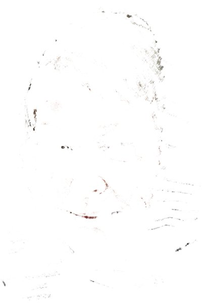 |

## colours-spiral

A single line spirals out from the centre of the image. It is thicker where the image is darker, takes the colour underneath, and is pulled sideways towards darker areas. The background stays transparent. This is a new effect: only a fragment of the original script of this name survives.

### Defaults

Turns 8 output pixels apart on a canvas twice the size of the input. In the darkest areas the line is as wide as the gap between turns, so they close up.

```sh
effekt colours-spiral test-images/lena-test.png out.png
```

| Input | Output (1024x1024) |
| --- | --- |
|  | 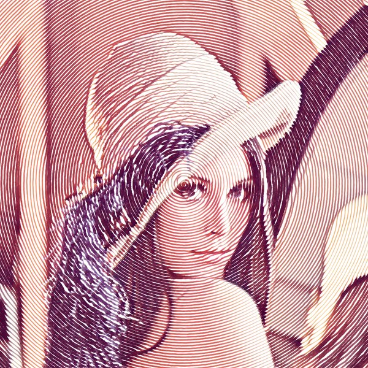 |

### `--colour 0 --bend 0`

Black ink and no pull from the image leave a perfect spiral whose width alone carries the picture.

```sh
effekt colours-spiral test-images/lena-test.png out.png --colour 0 --bend 0
```

| Input | Output (1024x1024) |
| --- | --- |
|  | 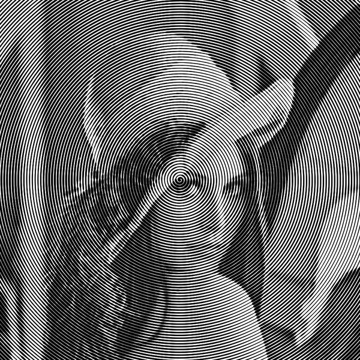 |

### `--bend 4 --spacing 12`

A stronger pull makes the line swerve at every edge, and wider turns give it room to. Edges become ragged and textured areas break into waves.

```sh
effekt colours-spiral test-images/lena-test.png out.png --bend 4 --spacing 12
```

| Input | Output (1024x1024) |
| --- | --- |
|  | 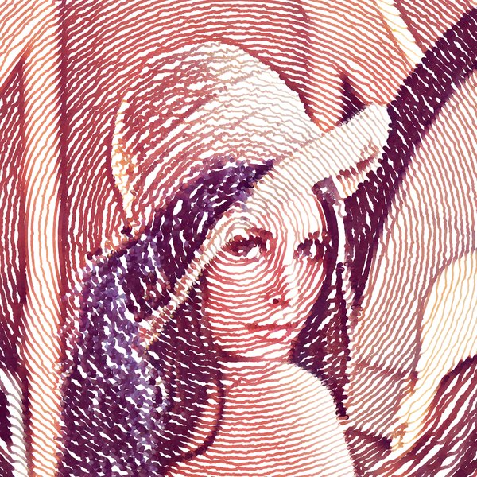 |

### `--spacing 4`

Turns half as far apart resolve more of the image and take about twice as long to draw.

```sh
effekt colours-spiral test-images/lena-test.png out.png --spacing 4
```

| Input | Output (1024x1024) |
| --- | --- |
|  | 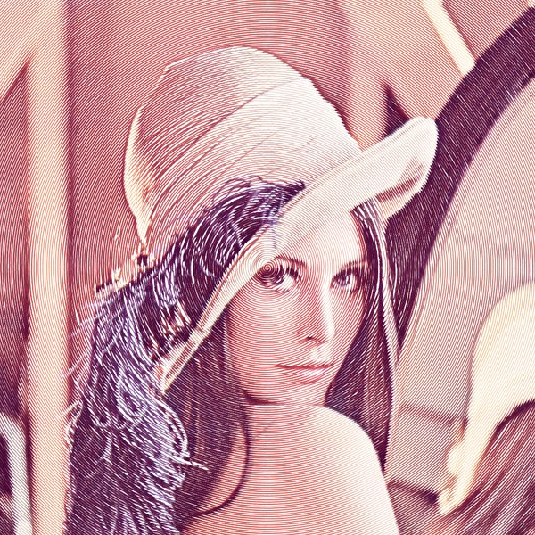 |

### `--width 0.6 --min-width 0.3`

Narrowing the range between the thinnest and thickest line keeps every turn separate and flattens the contrast.

```sh
effekt colours-spiral test-images/lena-test.png out.png --width 0.6 --min-width 0.3
```

| Input | Output (1024x1024) |
| --- | --- |
|  | 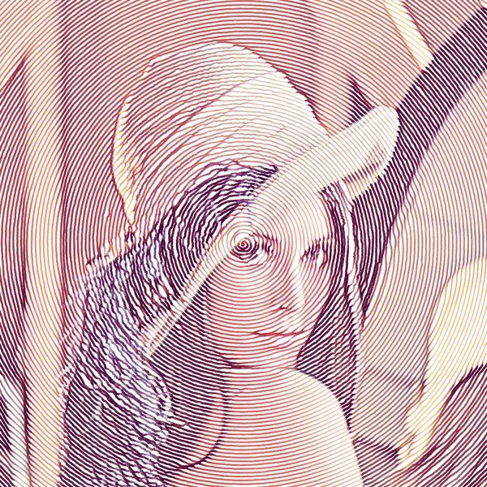 |

### A portrait with `--scale 1`

The spiral runs out to the corners, so on a tall image the last turns are only arcs at the top and bottom.

```sh
effekt colours-spiral test-images/lena-old.jpg out.png --scale 1
```

| Input | Output (1000x1500) |
| --- | --- |
|  | 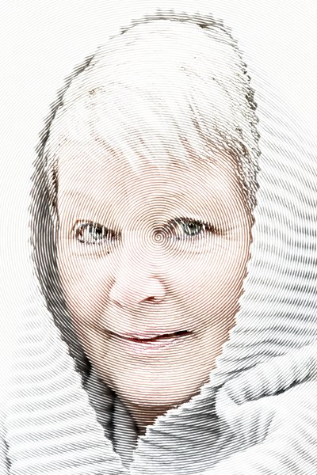 |

## ebs

A swarm of entities flocks across the canvas leaving coloured trails, then respawns somewhere else. The last argument is the density: the number of steps the swarm takes. The output is the size of the input.

### Density 5000

5000 steps of the default 20 entities: a loose, spiky sketch.

```sh
effekt ebs test-images/lena-test.png out.png 5000
```

| Input | Output (512x512) |
| --- | --- |
|  | 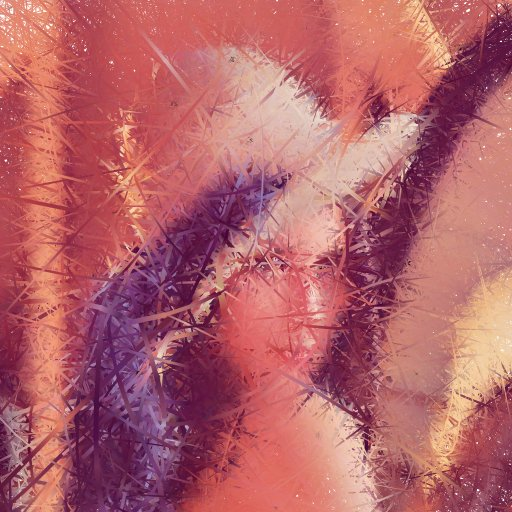 |

### Density 20000

More steps fill the canvas and smooth the result.

```sh
effekt ebs test-images/lena-test.png out.png 20000
```

| Input | Output (512x512) |
| --- | --- |
|  |  |

### `--entities 5`

A smaller swarm draws fewer, thinner trails and leaves gaps, even at the same density.

```sh
effekt ebs test-images/lena-test.png out.png 20000 --entities 5
```

| Input | Output (512x512) |
| --- | --- |
|  | 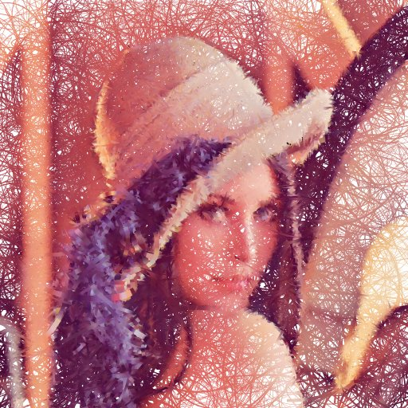 |

### `--island 200`

The swarm travels 200 steps before respawning instead of 25, so the trails become long streaks that wander off the subject.

```sh
effekt ebs test-images/lena-test.png out.png 5000 --island 200
```

| Input | Output (512x512) |
| --- | --- |
|  | 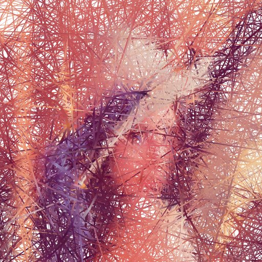 |

### A larger portrait

A bigger image needs more steps for the same coverage; 20000 is enough for this 1000x1500 photo.

```sh
effekt ebs test-images/lena-old.jpg out.png 20000
```

| Input | Output (1000x1500) |
| --- | --- |
|  |  |

## halftone

Prints the image as a grid of dots, the way newspapers do. Every dot sits on a fixed grid and only its size changes: big where the image is dark, small where it is light.

### Defaults

Black dots 8 output pixels apart, on a grid turned 45 degrees, on a canvas twice the size of the input.

```sh
effekt halftone test-images/lena-test.png out.png
```

| Input | Output (1024x1024) |
| --- | --- |
|  |  |

### `--cmyk`

Four grids, one each of cyan, magenta, yellow and black ink, at different angles so that the dots form rosettes instead of piling up.

```sh
effekt halftone test-images/lena-test.png out.png --cmyk
```

| Input | Output (1024x1024) |
| --- | --- |
|  | 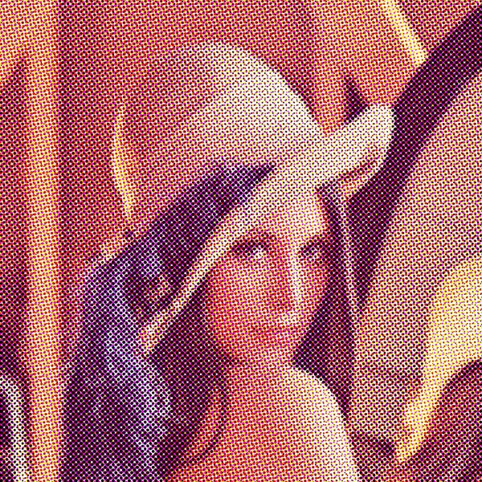 |

### `--cell 20 --angle 15`

Dots further apart show the grid itself and lose the fine detail. `--angle` turns the grid.

```sh
effekt halftone test-images/lena-test.png out.png --cell 20 --angle 15
```

| Input | Output (1024x1024) |
| --- | --- |
|  |  |

### `--cell 4 --cmyk`

A fine screen: from a distance the dots merge into continuous colour.

```sh
effekt halftone test-images/lena-test.png out.png --cell 4 --cmyk
```

| Input | Output (1024x1024) |
| --- | --- |
|  | 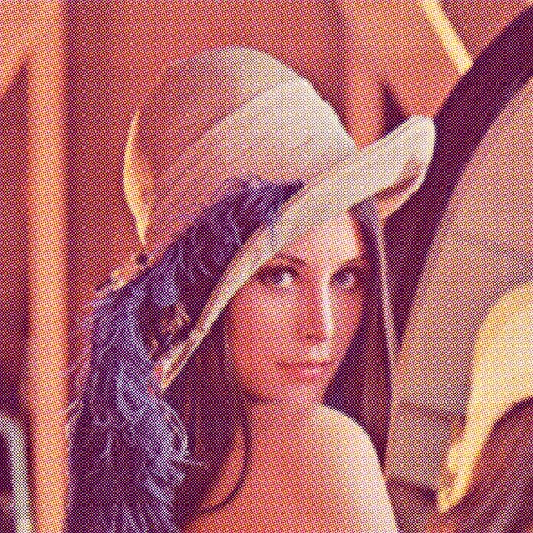 |

### A portrait with `--scale 1`

`--cell` is in output pixels, so on a canvas the size of the input the same dots are coarser relative to the picture.

```sh
effekt halftone test-images/lena-old.jpg out.png --scale 1
```

| Input | Output (1000x1500) |
| --- | --- |
|  | 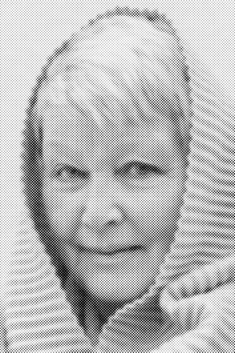 |

## hatch

Draws short pen strokes that follow the image's contours, like the lines of an engraving. Each stroke only crosses pixels darker than its own randomly chosen ink level, so dark areas fill with lines and light areas stay as white paper. Results vary between runs unless `--seed` is given.

### Defaults

Strokes up to 16 input pixels long on a canvas twice the size of the input. Where the image is flat they fall back to a 45 degree hatch.

```sh
effekt hatch test-images/lena-test.png out.png --seed 1
```

| Input | Output (1024x1024) |
| --- | --- |
|  |  |

### `--bias 0`

With no pull towards `--angle`, strokes follow whatever faint contours the flat areas have, which turns them into swirls.

```sh
effekt hatch test-images/lena-test.png out.png --seed 1 --bias 0
```

| Input | Output (1024x1024) |
| --- | --- |
|  | 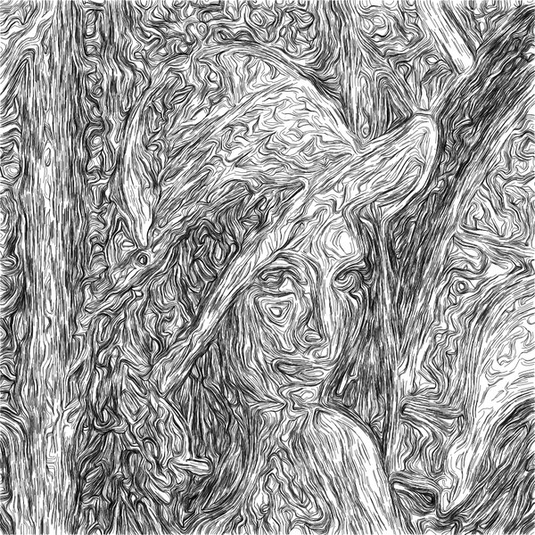 |

### `--bias 1 --angle 20`

A strong pull gives an almost uniform hatch at the chosen angle; only the sharpest edges still bend the strokes.

```sh
effekt hatch test-images/lena-test.png out.png --seed 1 --bias 1 --angle 20
```

| Input | Output (1024x1024) |
| --- | --- |
|  |  |

### `--density 0.3 --length 40`

Half as many strokes again, each allowed to run more than twice as far. Lines become long and flowing and the shadows start to close up.

```sh
effekt hatch test-images/lena-test.png out.png --seed 1 --density 0.3 --length 40
```

| Input | Output (1024x1024) |
| --- | --- |
|  | 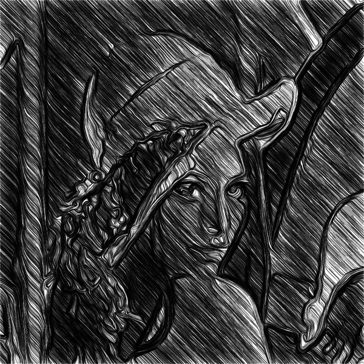 |

### `--colour 1 --density 1`

Each stroke takes the colour of the pixel it starts from, and a high density covers most of the paper, for a coloured-pencil look.

```sh
effekt hatch test-images/lena-test.png out.png --seed 1 --colour 1 --density 1
```

| Input | Output (1024x1024) |
| --- | --- |
|  | 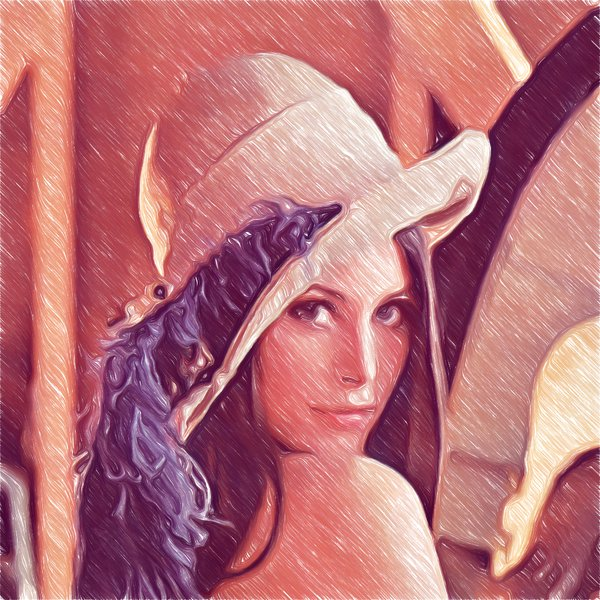 |

### A portrait with `--scale 1`

At the size of the input the same strokes are finer relative to the page.

```sh
effekt hatch test-images/lena-old.jpg out.png --seed 1 --scale 1
```

| Input | Output (1000x1500) |
| --- | --- |
|  | 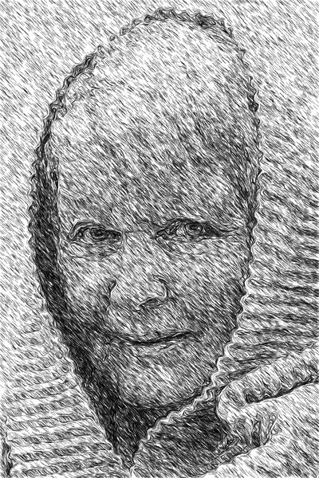 |

## quant

Splits the image into quarters wherever it finds detail and strokes each cell in the colour found there, so busy areas get small marks and calm areas large ones. The background stays transparent.

### Defaults

`--threshold 0` subdivides anywhere there is any detail at all, on a canvas four times the size of the input.

```sh
effekt quant test-images/lena-test.png out.png
```

| Input | Output (2048x2048) |
| --- | --- |
|  |  |

### `--threshold 0.1`

A cell is now only split when its average detail exceeds the threshold, so smooth regions stop early and stay as large strokes or gaps.

```sh
effekt quant test-images/lena-test.png out.png --threshold 0.1
```

| Input | Output (2048x2048) |
| --- | --- |
|  | 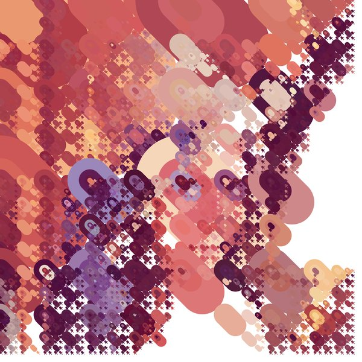 |

### `--threshold 0.15`

Higher still, and only the busiest areas are drawn. Much above 0.2 nothing is drawn for this image.

```sh
effekt quant test-images/lena-test.png out.png --threshold 0.15
```

| Input | Output (2048x2048) |
| --- | --- |
|  | 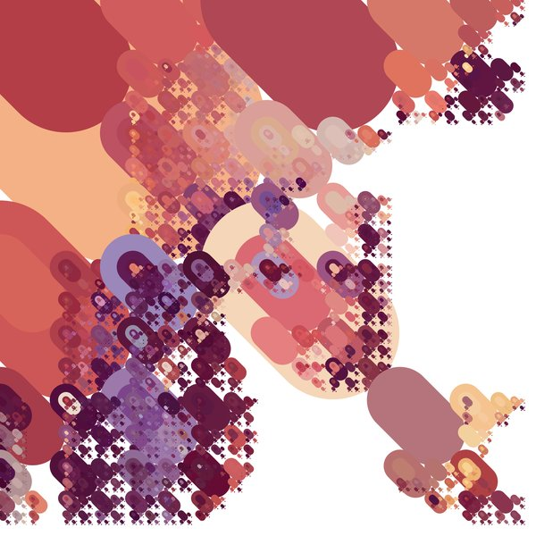 |

### A portrait with `--scale 1`

The same pattern on a canvas the size of the input.

```sh
effekt quant test-images/lena-old.jpg out.png --scale 1
```

| Input | Output (1000x1500) |
| --- | --- |
|  |  |

## stipple

Draws the image with dots of one size, packed closer together where it is darker. The dots are first scattered at random and then repeatedly nudged apart until they are evenly spaced. Results vary between runs unless `--seed` is given.

### Defaults

20,000 dots, relaxed 30 times, on a canvas twice the size of the input.

```sh
effekt stipple test-images/lena-test.png out.png --seed 1
```

| Input | Output (1024x1024) |
| --- | --- |
|  |  |

### `--iterations 0`

The dots where they first land. The tones are the same but the dots clump and overlap; relaxing is what gives stippling its even texture.

```sh
effekt stipple test-images/lena-test.png out.png --seed 1 --iterations 0
```

| Input | Output (1024x1024) |
| --- | --- |
|  | 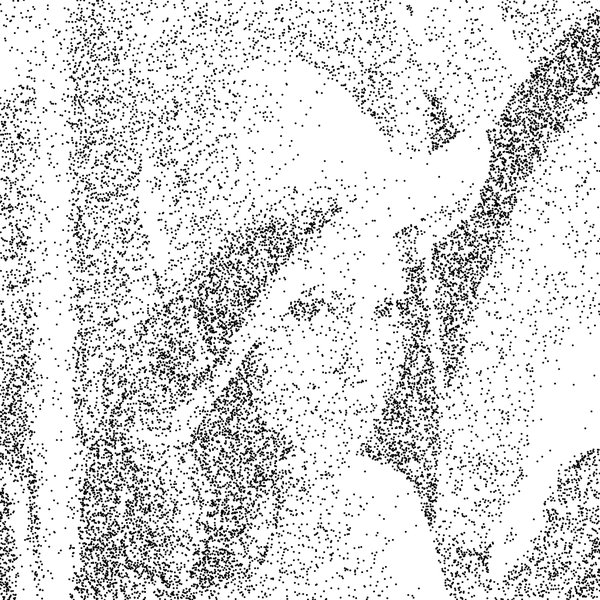 |

### `--contrast 1`

With darkness used as it is, dots spread over the mid-tones too and the picture flattens. The default of 3 clears the light areas.

```sh
effekt stipple test-images/lena-test.png out.png --seed 1 --contrast 1
```

| Input | Output (1024x1024) |
| --- | --- |
|  | 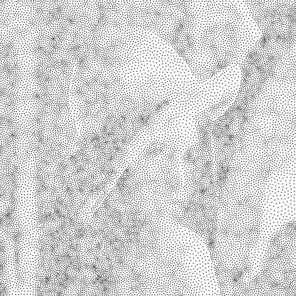 |

### `--dots 4000 --size 3`

Fewer, bigger dots keep only the main shapes.

```sh
effekt stipple test-images/lena-test.png out.png --seed 1 --dots 4000 --size 3
```

| Input | Output (1024x1024) |
| --- | --- |
|  | 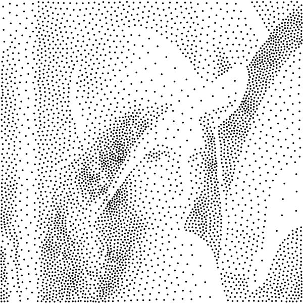 |

### `--colour 1 --contrast 1 --dots 30000 --size 2.5`

Each dot takes the colour of the image beneath it. Many large dots and a low contrast cover enough of the paper for the colours to read.

```sh
effekt stipple test-images/lena-test.png out.png --seed 1 --colour 1 --contrast 1 --dots 30000 --size 2.5
```

| Input | Output (1024x1024) |
| --- | --- |
|  |  |

### A portrait with `--scale 1`

A larger input gets the same 20,000 dots, so each one covers less of the page.

```sh
effekt stipple test-images/lena-old.jpg out.png --seed 1 --scale 1
```

| Input | Output (1000x1500) |
| --- | --- |
|  | 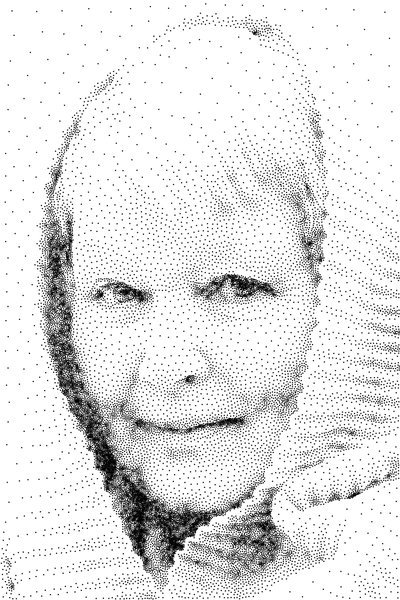 |

## string-art

Winds a single thread between pins set around the edge of the image, always heading for the pin that crosses the most darkness not yet covered. The pins sit on the ellipse that fits the image, so the corners stay empty.

### Defaults

300 pins and a fine, translucent thread. Winding stops when no line would add anything, which here is well short of the 5000 lines allowed.

```sh
effekt string-art test-images/lena-test.png out.png
```

| Input | Output (1024x1024) |
| --- | --- |
|  |  |

### `--lines 800`

Stopped early, only the darkest shapes have been found.

```sh
effekt string-art test-images/lena-test.png out.png --lines 800
```

| Input | Output (1024x1024) |
| --- | --- |
|  | 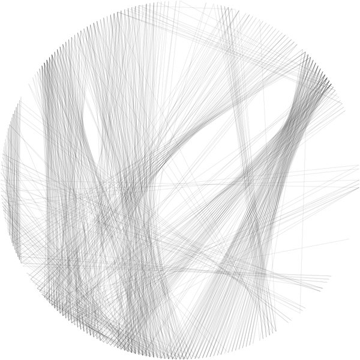 |

### `--width 0.8 --opacity 0.6 --pins 120`

A heavier thread on fewer pins covers the image in far fewer lines and looks more like the real craft, at the cost of detail.

```sh
effekt string-art test-images/lena-test.png out.png --width 0.8 --opacity 0.6 --pins 120
```

| Input | Output (1024x1024) |
| --- | --- |
|  | 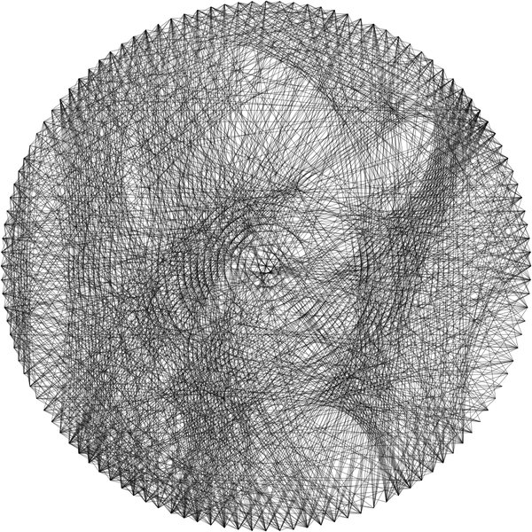 |

### A portrait with `--scale 1`

On an image that is not square the pins follow an ellipse.

```sh
effekt string-art test-images/lena-old.jpg out.png --scale 1
```

| Input | Output (1000x1500) |
| --- | --- |
|  | 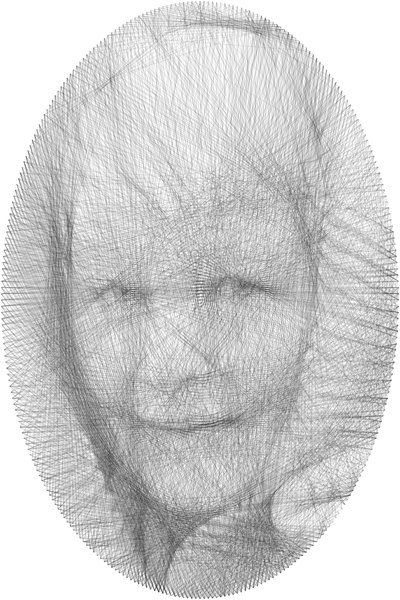 |
