# Examples

What each effect does and how its options change the result. Every example shows the input image, the command, and what the command produced.

The results are reduced to fit the page, and transparent areas are shown as white. The real size of each output is given above it. Commands assume `effekt` is installed; from a checkout, put `uv run` in front.

This page and its images are generated by `uv run python docs/make_examples.py`.

- [bloom](#bloom)
- [regrain](#regrain)
- [colours-natural](#colours-natural)
- [ebs](#ebs)
- [quant](#quant)

## bloom

Every output pixel emits an additive disc of light. Brighter pixels emit bigger discs, so light areas spread and burn out.

### Defaults

`--exposure 10` on a canvas twice the size of the input (`--scale 2`). Each pixel's disc reaches up to 10 pixels, so all but the darkest areas clip to white.

```sh
effekt bloom test-images/lena-test.png out.png
```

| Input | Output (1024x1024) |
| --- | --- |
| 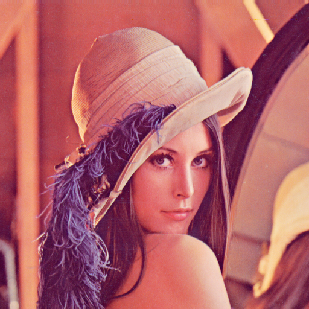 | 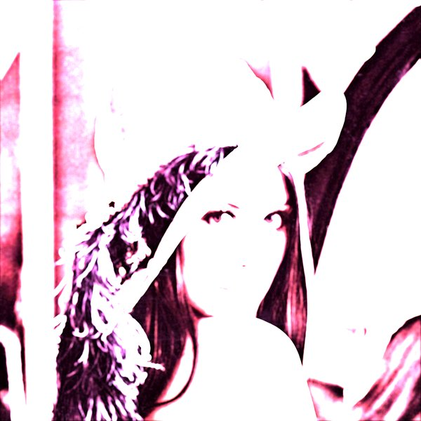 |

### `--exposure 3`

Overall brightness follows the exposure. At 3 the highlights still clip but the midtones come back.

```sh
effekt bloom test-images/lena-test.png out.png --exposure 3
```

| Input | Output (1024x1024) |
| --- | --- |
|  | 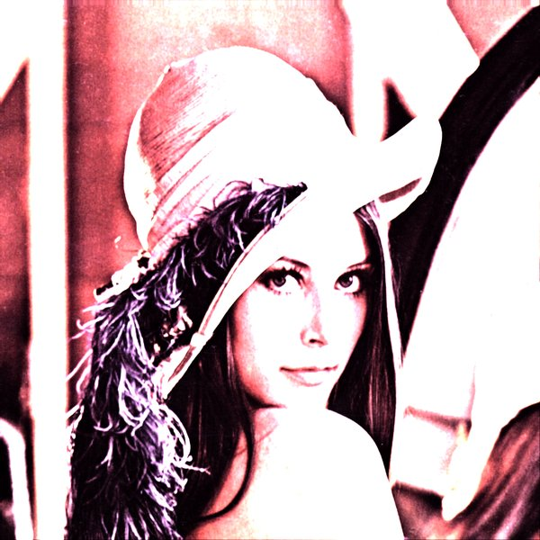 |

### `--exposure 1`

Close to the source, with harder contrast and a slight glow around highlights.

```sh
effekt bloom test-images/lena-test.png out.png --exposure 1
```

| Input | Output (1024x1024) |
| --- | --- |
|  | 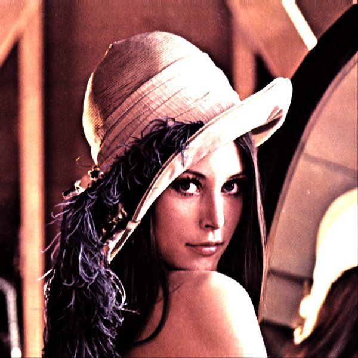 |

### `--exposure 0.5`

Underexposed: only the brightest areas register.

```sh
effekt bloom test-images/lena-test.png out.png --exposure 0.5
```

| Input | Output (1024x1024) |
| --- | --- |
|  | 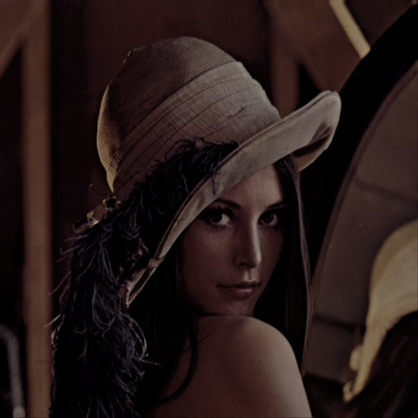 |

### `--min-exposure 1.5`

`--min-exposure` is a floor on the disc radius. Set above the exposure, it makes every pixel emit a full-size disc, which washes the picture out.

```sh
effekt bloom test-images/lena-test.png out.png --exposure 1 --min-exposure 1.5
```

| Input | Output (1024x1024) |
| --- | --- |
|  | 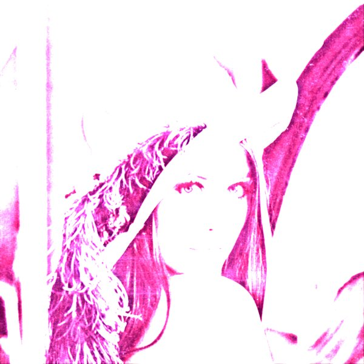 |

### A bright portrait at its own size

`--scale 1` keeps the output the size of the input. A low exposure holds the detail of a light photo, at the cost of a dim, grey result.

```sh
effekt bloom test-images/lena-old.jpg out.png --scale 1 --exposure 0.5
```

| Input | Output (1000x1500) |
| --- | --- |
| 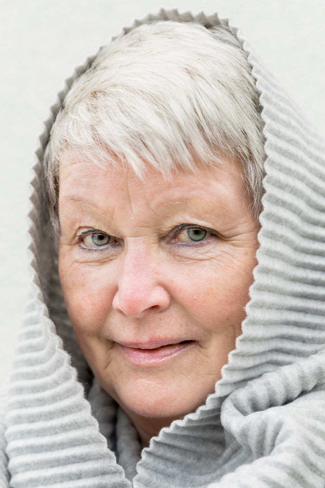 | 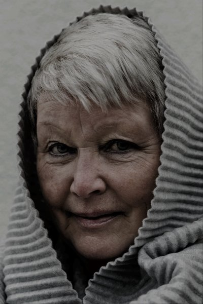 |

## regrain

Rebuilds the image from randomly placed red, green and blue grains, like the dye clouds of colour film. The examples pass `--seed` so they can be reproduced; without it every run is different.

### Defaults

A canvas four times the size of the input, one sample per output pixel. The grain is fine at this size and the colours shift towards red.

```sh
effekt regrain test-images/lena-test.png out.png --seed 1
```

| Input | Output (2048x2048) |
| --- | --- |
|  | 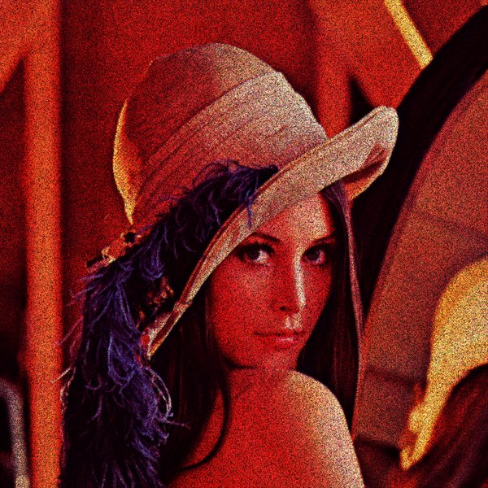 |

### `--grain 2`

Bigger grains overlap more, so the picture gets brighter and flatter.

```sh
effekt regrain test-images/lena-test.png out.png --seed 1 --grain 2
```

| Input | Output (2048x2048) |
| --- | --- |
|  | 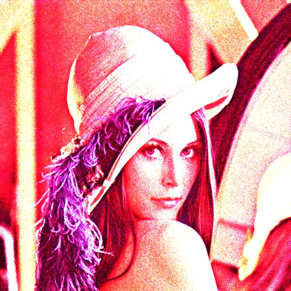 |

### `--grain 0.3`

Small grains leave most of the black canvas uncovered.

```sh
effekt regrain test-images/lena-test.png out.png --seed 1 --grain 0.3
```

| Input | Output (2048x2048) |
| --- | --- |
|  | 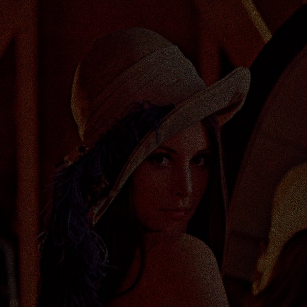 |

### `--iso 0.2`

`--iso` is how much light each grain holds. Lower values darken the picture without changing the grain size.

```sh
effekt regrain test-images/lena-test.png out.png --seed 1 --iso 0.2
```

| Input | Output (2048x2048) |
| --- | --- |
|  | 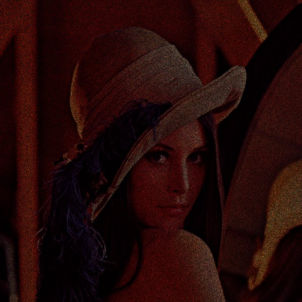 |

### `--exposure 0.25`

A quarter of the samples: darker, more speckled, and four times quicker to render.

```sh
effekt regrain test-images/lena-test.png out.png --seed 1 --exposure 0.25
```

| Input | Output (2048x2048) |
| --- | --- |
|  |  |

### Coarse grain with `--scale 1`

Grain size is measured in output pixels, so on a canvas the size of the input the grains are four times coarser relative to the picture.

```sh
effekt regrain test-images/lena-old.jpg out.png --seed 1 --scale 1
```

| Input | Output (1000x1500) |
| --- | --- |
|  | 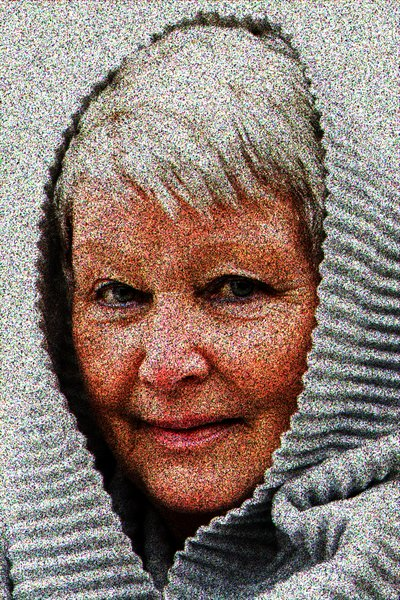 |

## colours-natural

A pen wanders over the canvas, pulled towards darker areas, and strokes in the colour underneath. The first argument is a file of stroke data: any file works, and each byte steers one stroke, so a bigger file means more strokes. Here the image file doubles as its own stroke data. The background stays transparent.

### Defaults

473,831 strokes on a canvas four times the size of the input. Strokes are widest where the image changes fastest, so edges come out and flat areas stay empty.

```sh
effekt colours-natural test-images/lena-test.png test-images/lena-test.png out.png
```

| Input | Output (2048x2048) |
| --- | --- |
|  | 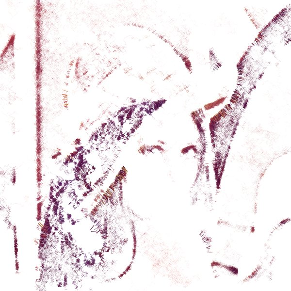 |

### `--island 400`

The pen jumps to a new random spot every 400 steps instead of every 4000, which spreads the strokes more evenly.

```sh
effekt colours-natural test-images/lena-test.png test-images/lena-test.png out.png --island 400
```

| Input | Output (2048x2048) |
| --- | --- |
|  | 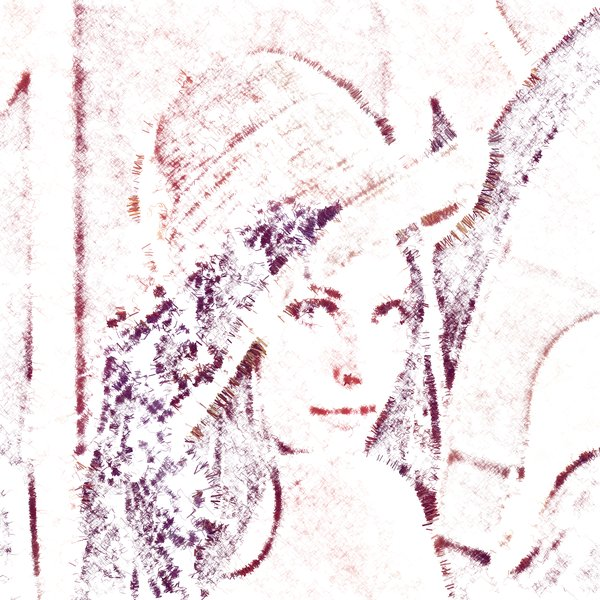 |

### `--damp 0.6`

The pen keeps more of its speed between strokes, so it travels further and the marks become longer and looser.

```sh
effekt colours-natural test-images/lena-test.png test-images/lena-test.png out.png --damp 0.6
```

| Input | Output (2048x2048) |
| --- | --- |
|  | 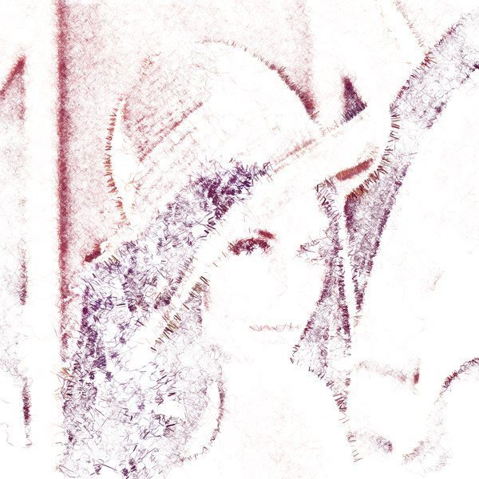 |

### `--scale 1`

On a canvas the size of the input the strokes are thinner and cover much less.

```sh
effekt colours-natural test-images/lena-test.png test-images/lena-test.png out.png --scale 1
```

| Input | Output (512x512) |
| --- | --- |
|  | 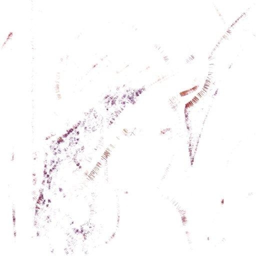 |

### A bright, low-contrast portrait

This effect needs contrast: stroke width follows the local gradient, and a pale image gives it little to work with, so very little is drawn.

```sh
effekt colours-natural test-images/lena-test.png test-images/lena-old.jpg out.png --scale 2
```

| Input | Output (2000x3000) |
| --- | --- |
|  | 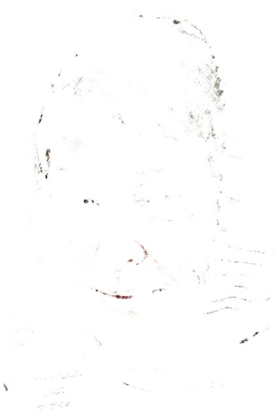 |

## ebs

A swarm of entities flocks across the canvas leaving coloured trails, then respawns somewhere else. The last argument is the density: the number of steps the swarm takes. The output is the size of the input.

### Density 5000

5000 steps of the default 20 entities: a loose, spiky sketch.

```sh
effekt ebs test-images/lena-test.png out.png 5000
```

| Input | Output (512x512) |
| --- | --- |
|  | 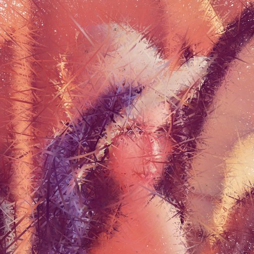 |

### Density 20000

More steps fill the canvas and smooth the result.

```sh
effekt ebs test-images/lena-test.png out.png 20000
```

| Input | Output (512x512) |
| --- | --- |
|  | 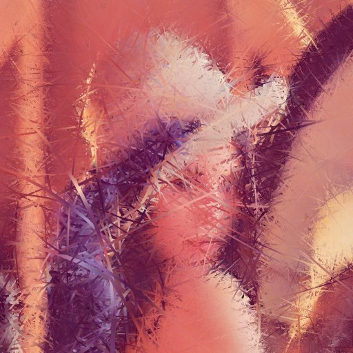 |

### `--entities 5`

A smaller swarm draws fewer, thinner trails and leaves gaps, even at the same density.

```sh
effekt ebs test-images/lena-test.png out.png 20000 --entities 5
```

| Input | Output (512x512) |
| --- | --- |
|  | 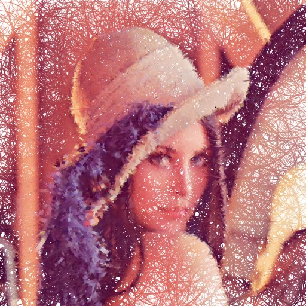 |

### `--island 200`

The swarm travels 200 steps before respawning instead of 25, so the trails become long streaks that wander off the subject.

```sh
effekt ebs test-images/lena-test.png out.png 5000 --island 200
```

| Input | Output (512x512) |
| --- | --- |
|  | 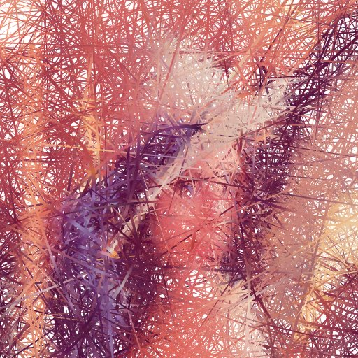 |

### A larger portrait

A bigger image needs more steps for the same coverage; 20000 is enough for this 1000x1500 photo.

```sh
effekt ebs test-images/lena-old.jpg out.png 20000
```

| Input | Output (1000x1500) |
| --- | --- |
|  | 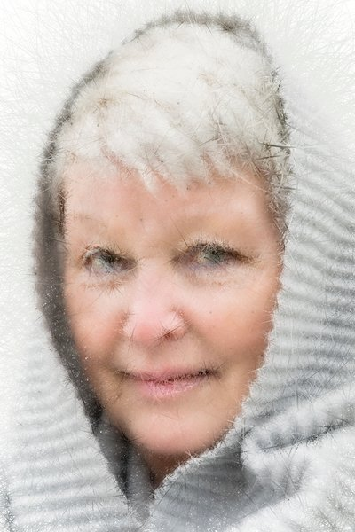 |

## quant

Splits the image into quarters wherever it finds detail and strokes each cell in the colour found there, so busy areas get small marks and calm areas large ones. The background stays transparent.

### Defaults

`--threshold 0` subdivides anywhere there is any detail at all, on a canvas four times the size of the input.

```sh
effekt quant test-images/lena-test.png out.png
```

| Input | Output (2048x2048) |
| --- | --- |
|  | 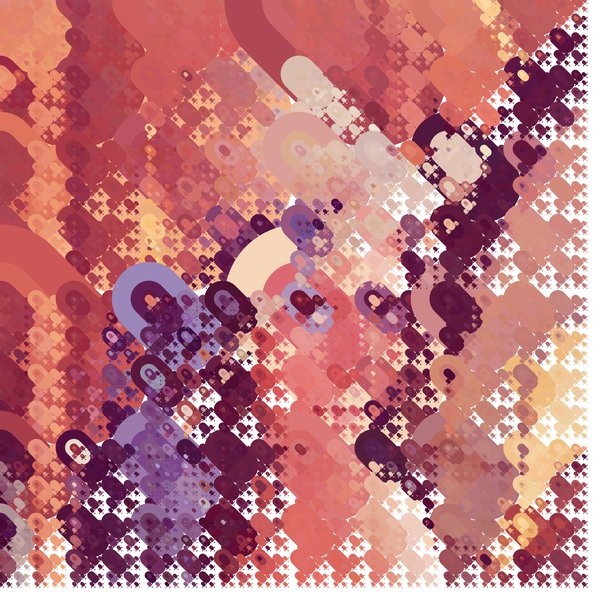 |

### `--threshold 0.1`

A cell is now only split when its average detail exceeds the threshold, so smooth regions stop early and stay as large strokes or gaps.

```sh
effekt quant test-images/lena-test.png out.png --threshold 0.1
```

| Input | Output (2048x2048) |
| --- | --- |
|  | 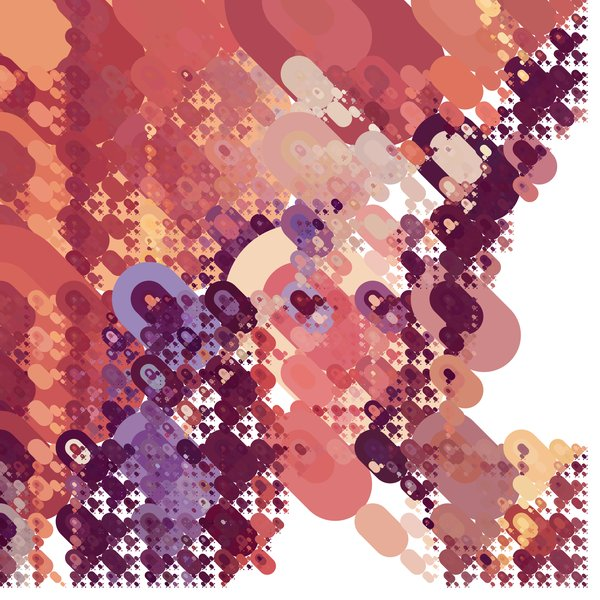 |

### `--threshold 0.15`

Higher still, and only the busiest areas are drawn. Much above 0.2 nothing is drawn for this image.

```sh
effekt quant test-images/lena-test.png out.png --threshold 0.15
```

| Input | Output (2048x2048) |
| --- | --- |
|  | 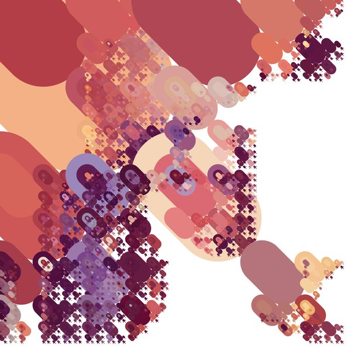 |

### A portrait with `--scale 1`

The same pattern on a canvas the size of the input.

```sh
effekt quant test-images/lena-old.jpg out.png --scale 1
```

| Input | Output (1000x1500) |
| --- | --- |
|  | 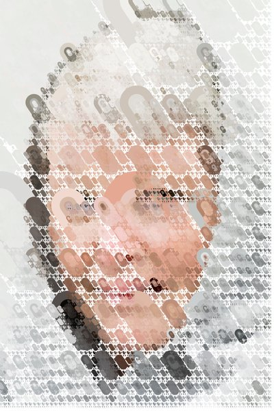 |
