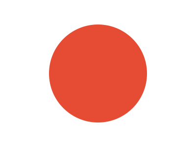

# Your first picture

<!-- nav -->
[Contents](README.md) · [Drawing →](02-drawing.md)
<!-- /nav -->

On this page you install the libraries and draw a red circle. The script is twelve lines long, and every later page is built from the same few moves.

## Install the libraries

You need three libraries. Install them into a [virtual environment](https://docs.python.org/3/tutorial/venv.html) with pip:

```sh
python -m pip install pycairo pillow numpy
```

| Library | What it is for | First used |
| --- | --- | --- |
| [pycairo](https://pycairo.readthedocs.io/en/latest/) | drawing shapes | this page |
| [Pillow](https://pillow.readthedocs.io/en/stable/) | opening photo files | page 3 |
| [NumPy](https://numpy.org/doc/stable/user/absolute_beginners.html) | holding a photo as a grid of numbers | page 3 |

pycairo is Python's way of talking to cairo, a drawing library written in C. If pip fails while installing it, cairo itself is probably missing from your computer. pycairo's [Getting Started page](https://pycairo.readthedocs.io/en/latest/getting_started.html) lists what to install on each system.

## Draw a circle

Save this as `circle.py` and run it with `python circle.py`:

<!-- code: code/01_circle.py -->
```python
import math

import cairo

surface = cairo.ImageSurface(cairo.FORMAT_ARGB32, 400, 300)
context = cairo.Context(surface)

context.set_source_rgb(1.0, 1.0, 1.0)
context.paint()

context.set_source_rgb(0.9, 0.3, 0.2)
context.arc(200, 150, 100, 0, math.tau)
context.fill()

surface.write_to_png("circle.png")
```

It writes `circle.png`:



## The paper and the hand

Two lines set everything up, and they are the two ideas you need most.

```python
surface = cairo.ImageSurface(cairo.FORMAT_ARGB32, 400, 300)
context = cairo.Context(surface)
```

The [surface](09-glossary.md#surface "The sheet of paper that cairo draws on. An image surface is a grid of pixels held in memory, which can be saved as a PNG file.") is the **sheet of paper**. This one is 400 [pixels](09-glossary.md#pixel "One of the tiny squares of colour that a photo, a screen or an image surface is made of.") wide and 300 tall, and it starts out completely see-through.

The [context](09-glossary.md#context "The hand that draws on a surface. It carries out your drawing instructions and remembers the current colour, pen width and path.") is the **hand that draws on the paper**. You never touch the paper yourself. You tell the hand what to do, and it does it to the paper it was given.

The hand also remembers things between instructions: which colour it has picked up, how thick its pen is, and what shape it has sketched so far. That is why the script can say "use red" on one line and "fill it in" two lines later, without mentioning red again.

<details>
<summary>Why split the paper and the hand into two things?</summary>

Because they change independently. The same hand could draw on a different kind of paper: cairo also has surfaces that write PDF and SVG files instead of holding pixels. And the settings the hand remembers (colour, pen width) are about how you are drawing, not about the paper.

pycairo's documentation lists the [kinds of surface](https://pycairo.readthedocs.io/en/latest/reference/surfaces.html) and everything a [context](https://pycairo.readthedocs.io/en/latest/reference/context.html) can do.

</details>

<details>
<summary>What does <code>FORMAT_ARGB32</code> mean?</summary>

It says what each pixel on the paper stores: how see-through it is (A, for [alpha](09-glossary.md#alpha "How solid a colour is, from 0.0 (invisible) to 1.0 (hides everything beneath it).")) and how much red, green and blue it has (RGB). The 32 is the number of bits used for those four values together. It is the format to use unless you have a reason not to.

</details>

## Pick, sketch, commit

Every mark the script makes follows the same three beats.

```python
context.set_source_rgb(0.9, 0.3, 0.2)  # 1. pick a colour
context.arc(200, 150, 100, 0, math.tau)  # 2. sketch a shape
context.fill()  # 3. commit: colour the shape in
```

1. **Pick.** `set_source_rgb` loads the hand with a colour, given as amounts of red, green and blue ([RGB](09-glossary.md#rgb "A colour described as amounts of red, green and blue light. Cairo wants each amount from 0.0 to 1.0; image files store each from 0 to 255.")). Each amount runs from 0.0 (none) to 1.0 (full), so `(0.9, 0.3, 0.2)` is mostly red.
2. **Sketch.** `arc` sketches a circle: centre at 200 across and 150 down, radius 100. Nothing is visible yet. The sketch is called a [path](09-glossary.md#path "The shape the context has sketched so far but not yet drawn, like a faint pencil line. It becomes visible only when filled or stroked."), and it is like a faint pencil line that only the hand can see.
3. **Commit.** [`fill`](09-glossary.md#fill "Colouring in the inside of a path with the current colour. The path is erased afterwards.") colours in the inside of the path with the colour the hand is holding. Now the paper has changed.

The white background is the same idea with no shape: pick white, then `paint()`, which covers the whole paper.

Last, `surface.write_to_png("circle.png")` saves the paper as an image file.

<details>
<summary>Why do colours go from 0 to 1 and not 0 to 255?</summary>

Image files usually store each colour as a whole number from 0 to 255, and you will meet those numbers on page 3. Cairo uses fractions instead, because a fraction means the same thing however the colour ends up being stored. To convert, divide by 255.

</details>

<details>
<summary>What are the last two numbers given to <code>arc</code>?</summary>

The angles where the arc starts and stops. `0` to `math.tau` is all the way round, which makes a full circle. `math.tau` is 2π, about 6.28: the size of a full turn when angles are measured in [radians](09-glossary.md#radian "A unit for angles in which a full turn is 2π (about 6.28) instead of 360 degrees. Python's maths functions use it."). Page 6 covers angles properly.

Try `context.arc(200, 150, 100, 0, math.tau / 2)` to get half a circle.

</details>

## Try it

- Change the three colour numbers. What gives yellow? (Red and green, no blue.)
- Make the paper 800 by 600. The circle stays where it was, in the top-left quarter. Why?
- Draw a second, smaller circle on top of the first by repeating the three beats.
- Delete the two lines that paint the background, and open the result in an image viewer. The area around the circle is see-through.

<!-- nav -->
[Contents](README.md) · [Drawing →](02-drawing.md)
<!-- /nav -->
