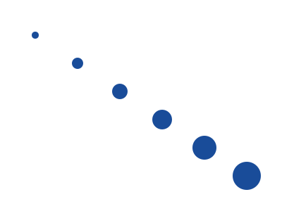
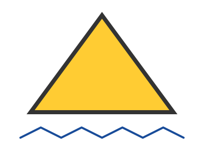
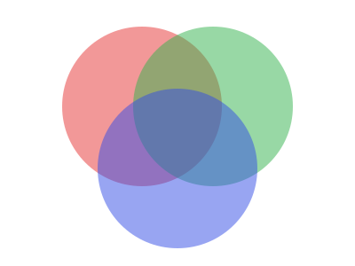

# Drawing

<!-- nav -->
[← Your first picture](01-first-picture.md) · [Contents](README.md) · [Reading a photo →](03-reading-a-photo.md)
<!-- /nav -->

This page covers the rest of what the hand can do: where things go, shapes made of straight lines, outlines, and colour you can see through.

## Where things go

Every position is two numbers: how far across, then how far down. This script draws six dots, each one 60 pixels further right and 40 further down than the last.

<!-- code: code/02_coordinates.py -->
```python
import math

import cairo

surface = cairo.ImageSurface(cairo.FORMAT_ARGB32, 400, 300)
context = cairo.Context(surface)

context.set_source_rgb(1.0, 1.0, 1.0)
context.paint()

# Six dots. Each one is 60 pixels further right and 40 pixels further down.
context.set_source_rgb(0.1, 0.3, 0.6)
for step in range(6):
    x = 50 + step * 60
    y = 50 + step * 40
    context.arc(x, y, 5 + step * 3, 0, math.tau)
    context.fill()

surface.write_to_png("coordinates.png")
```



The first dot, at `(50, 50)`, is in the **top** left. Position `(0, 0)` is the top-left corner of the paper, and the second number counts **downwards**. That is the opposite of the graphs you drew at school, and it catches everyone at least once.

<details>
<summary>Why does y point down?</summary>

Screens and image files store their rows from the top, the way a page of text is read, and almost every drawing library follows them. It matters most on page 6: when y points down, angles turn clockwise instead of anticlockwise.

</details>

## Shapes from lines

`arc` sketches a circle in one go. Other shapes you sketch corner by corner.

<!-- code: code/02_paths.py -->
```python
import cairo

surface = cairo.ImageSurface(cairo.FORMAT_ARGB32, 400, 300)
context = cairo.Context(surface)

context.set_source_rgb(1.0, 1.0, 1.0)
context.paint()

# Sketch a triangle: three corners, then back to the start.
context.move_to(200, 30)
context.line_to(340, 220)
context.line_to(60, 220)
context.close_path()

# Colour it in, but keep the sketch so that it can be outlined too.
context.set_source_rgb(1.0, 0.8, 0.2)
context.fill_preserve()

context.set_source_rgb(0.2, 0.2, 0.2)
context.set_line_width(8)
context.stroke()

# A zigzag is a path that is never closed, so it can only be stroked.
context.move_to(40, 270)
for corner in range(1, 9):
    context.line_to(40 + corner * 40, 270 if corner % 2 == 0 else 250)
context.set_source_rgb(0.1, 0.3, 0.6)
context.set_line_width(4)
context.set_line_cap(cairo.LINE_CAP_ROUND)
context.set_line_join(cairo.LINE_JOIN_ROUND)
context.stroke()

surface.write_to_png("paths.png")
```



Think of the [path](09-glossary.md#path "The shape the context has sketched so far but not yet drawn, like a faint pencil line. It becomes visible only when filled or stroked.") as a pencil sketch:

- `move_to` lifts the pencil and puts it down somewhere.
- `line_to` draws a straight pencil line from where the pencil is to a new place.
- `close_path` draws a line back to where the sketch started.

## Fill and stroke

There are two ways to commit a sketch to the paper.

- [`fill`](09-glossary.md#fill "Colouring in the inside of a path with the current colour. The path is erased afterwards.") colours in the **inside**. You used it on page 1.
- [`stroke`](09-glossary.md#stroke "Going over a path with a pen of the current colour and line width. The path is erased afterwards.") goes over the **line itself** with a pen. `set_line_width` sets how thick the pen is.

Both of them **erase the sketch** when they finish, so the hand is ready for the next shape. The triangle needs its sketch twice, once to fill and once to stroke, so the script uses `fill_preserve`. It fills and keeps the sketch for the `stroke` that follows.

The zigzag is never closed, so it has no inside to fill. It can only be stroked.

<details>
<summary>What do the line cap and line join settings do?</summary>

A thick pen line has ends and corners, and cairo lets you choose their shape. `LINE_CAP_ROUND` rounds off the two ends of a line; `LINE_JOIN_ROUND` rounds the corners where two lines meet. Without them the ends are cut off square and the corners are pointed.

Delete those two lines from the script to see the difference. The effects in this project nearly always use round caps, because short strokes with square ends look like bricks.

</details>

## See-through colour

`set_source_rgba` takes a fourth number, [alpha](09-glossary.md#alpha "How solid a colour is, from 0.0 (invisible) to 1.0 (hides everything beneath it)."): how solid the colour is. At 1.0 it hides whatever is underneath. At 0.5 it is like tinted glass, and half of what is underneath shows through.

<!-- code: code/02_transparency.py -->
```python
import math

import cairo

surface = cairo.ImageSurface(cairo.FORMAT_ARGB32, 400, 300)
context = cairo.Context(surface)

context.set_source_rgb(1.0, 1.0, 1.0)
context.paint()

# The fourth number is alpha: 0.0 is invisible, 1.0 is solid.
context.set_source_rgba(0.9, 0.2, 0.2, 0.5)
context.arc(160, 120, 90, 0, math.tau)
context.fill()

context.set_source_rgba(0.2, 0.7, 0.3, 0.5)
context.arc(240, 120, 90, 0, math.tau)
context.fill()

context.set_source_rgba(0.2, 0.3, 0.9, 0.5)
context.arc(200, 190, 90, 0, math.tau)
context.fill()

surface.write_to_png("transparency.png")
```



Where two circles overlap, the colours mix, and the area gets darker because two layers of tint are stacked there.

That stacking is the trick behind most of this project's effects. Draw thousands of faint marks, let them pile up, and the places with more marks become darker. You never have to work out how dark a spot should be; you only decide where the marks go.

## Try it

- Add a fourth corner to the triangle to make a kite.
- Swap `fill_preserve` for `fill`. The outline disappears. Why?
- Set the line width of the zigzag to 20 and remove the round cap and join lines.
- Change the alpha of all three circles to 0.9, then to 0.1.

<!-- nav -->
[← Your first picture](01-first-picture.md) · [Contents](README.md) · [Reading a photo →](03-reading-a-photo.md)
<!-- /nav -->
