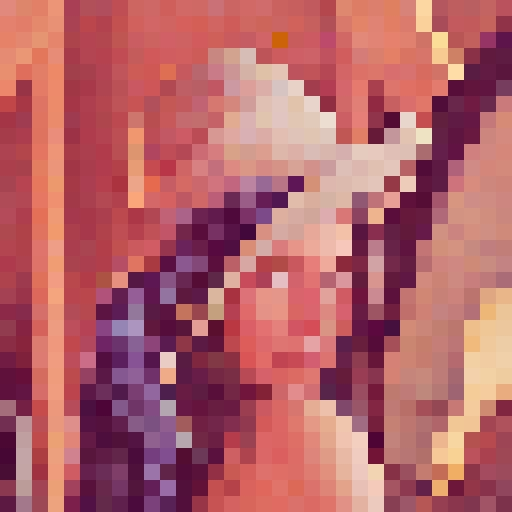

# Reading a photo

<!-- nav -->
[← Drawing](02-drawing.md) · [Contents](README.md) · [Halftone →](04-halftone.md)
<!-- /nav -->

So far the script decided everything it drew. From here on a photo decides. This page turns a photo into numbers that your code can look up.

Put a photo called `photo.png` in the folder you are working in.

## A photo is a grid of numbers

Two libraries share this job. [Pillow](https://pillow.readthedocs.io/en/stable/) knows how to open image files. [NumPy](https://numpy.org/doc/stable/user/absolute_beginners.html) holds the result as an [array](09-glossary.md#array "A grid of numbers held by NumPy, like a spreadsheet with one cell per pixel."): a grid of numbers, like a spreadsheet with one cell per [pixel](09-glossary.md#pixel "One of the tiny squares of colour that a photo, a screen or an image surface is made of.").

<!-- code: code/03_pixels.py -->
```python
import numpy as np
from PIL import Image

photo = Image.open("photo.png").convert("RGB")
colour = np.asarray(photo)
grey = np.asarray(photo.convert("L"))

print("photo size (width, height):", photo.size)
print("colour array shape:", colour.shape)
print("grey array shape:", grey.shape)
print("top-left pixel in colour:", colour[0, 0])
print("top-left pixel in grey:", grey[0, 0])
print("darkest and lightest grey:", grey.min(), grey.max())
```

With the test photo it prints:

<!-- output: 03_pixels -->
```text
photo size (width, height): (512, 512)
colour array shape: (512, 512, 3)
grey array shape: (512, 512)
top-left pixel in colour: [226 137 125]
top-left pixel in grey: 162
darkest and lightest grey: 25 245
```

Line by line:

- `Image.open("photo.png")` opens the file. `.convert("RGB")` makes sure every pixel is stored as red, green and blue, whatever the file used.
- `np.asarray(photo)` hands the pixels to NumPy as an array.
- `.convert("L")` makes a grey version, with one number per pixel instead of three.

The colour array's shape is `(512, 512, 3)`: 512 rows, 512 columns, and 3 numbers in each cell. Picture **three spreadsheets stacked on top of each other**, one each for red, green and blue.

The top-left pixel is `[226 137 125]`: a lot of red, less green and blue, so a pinkish colour. Each number runs from 0 to 255.

The grey array holds [luma](09-glossary.md#luma "How bright a pixel looks, as one number from 0 (black) to 255 (white). It is what a colour photo becomes when turned grey."): how bright each pixel looks, from 0 (black) to 255 (white).

<details>
<summary>How does a colour become one grey number?</summary>

Not by averaging. Eyes are much more sensitive to green than to blue, so Pillow weights the three colours: about 30% of the red, 59% of the green and 11% of the blue. Pillow's documentation gives the [exact formula](https://pillow.readthedocs.io/en/stable/reference/Image.html#PIL.Image.Image.convert), and lists the other [modes](https://pillow.readthedocs.io/en/stable/handbook/concepts.html#concept-modes) an image can be in.

</details>

## Rows first, then columns

To read one cell you give its row, then its column: `grey[row, column]`.

A row number is how far **down**, and a column number is how far **across**. So in the terms of page 2, where a position was `(x, y)`, the lookup is:

```python
grey[y, x]  # not grey[x, y]
```

This is back to front compared with cairo, and it is the most common mistake in this kind of code. On a square photo the mistake does not even cause an error. You just get a picture that is flipped along its diagonal.

Pillow adds to the confusion: `photo.size` is `(width, height)`, but the array's shape is `(height, width)`.

## Draw the photo with squares

Now use the numbers. This script looks at one pixel in every 16, across and down, and draws a square of that pixel's colour.

<!-- code: code/03_mosaic.py -->
```python
import cairo
import numpy as np
from PIL import Image

TILE = 16  # each tile covers this many pixels in each direction

photo = Image.open("photo.png").convert("RGB")
colour = np.asarray(photo) / 255
height, width, channels = colour.shape

surface = cairo.ImageSurface(cairo.FORMAT_ARGB32, width, height)
context = cairo.Context(surface)

for y in range(0, height, TILE):
    for x in range(0, width, TILE):
        red, green, blue = colour[y, x]
        context.set_source_rgb(red, green, blue)
        context.rectangle(x, y, TILE, TILE)
        context.fill()

surface.write_to_png("mosaic.png")
```

| The photo | The mosaic |
| --- | --- |
|  |  |

Three things are new:

- `np.asarray(photo) / 255` divides **every number in the array** by 255 in one go. That turns Pillow's 0 to 255 into the 0 to 1 that cairo wants. Doing arithmetic on a whole array at once is what NumPy is for.
- `range(0, height, TILE)` counts in steps: 0, 16, 32 and so on.
- `rectangle(x, y, width, height)` sketches a rectangle from its top-left corner.

The pattern in those two loops is the heart of every effect that follows: **go to a place, look up the photo there, and draw something that depends on what you found.**

<details>
<summary>Why does the surface have no white background this time?</summary>

The tiles cover every pixel of the paper, so there is nothing left for a background to show through.

</details>

## Try it

- Change `TILE` to 4, then to 64.
- Swap `colour[y, x]` for `colour[x, y]`. If your photo is not square, you may get an error instead of a flipped picture. Read the error message: it tells you which number was too big.
- Draw circles instead of squares, using `arc` from page 1. You will need `import math`, and a background.
- Use the grey array instead: `set_source_rgb(level, level, level)` with the same number three times gives a grey.

<!-- nav -->
[← Drawing](02-drawing.md) · [Contents](README.md) · [Halftone →](04-halftone.md)
<!-- /nav -->
