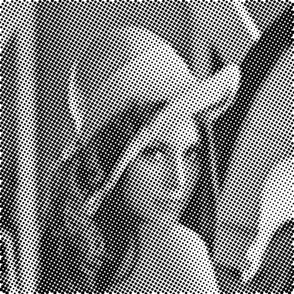

# Halftone

<!-- nav -->
[← Reading a photo](03-reading-a-photo.md) · [Contents](README.md) · [Chance →](05-chance.md)
<!-- /nav -->

A newspaper prints photos with black ink only. It fakes grey with dots: big dots where the photo is dark, small ones where it is light. From a distance the dots blur into shades of grey. This is called a [halftone](09-glossary.md#halftone "Printing shades of grey with dots of a single ink: large dots for dark areas, small ones for light."), and it is your first real effect.

## Dots on a grid

<!-- code: code/04_halftone.py -->
```python
import math

import cairo
import numpy as np
from PIL import Image

CELL = 6  # each dot stands for a square of this many photo pixels
SCALE = 2  # the drawing is this many times the size of the photo

photo = Image.open("photo.png").convert("L")
darkness = 1 - np.asarray(photo) / 255
height, width = darkness.shape

surface = cairo.ImageSurface(cairo.FORMAT_ARGB32, width * SCALE, height * SCALE)
context = cairo.Context(surface)
context.scale(SCALE, SCALE)

context.set_source_rgb(1.0, 1.0, 1.0)
context.paint()

context.set_source_rgb(0.0, 0.0, 0.0)
for y in range(0, height, CELL):
    for x in range(0, width, CELL):
        average = darkness[y : y + CELL, x : x + CELL].mean()
        # The dot's area, as a share of its square, matches the darkness.
        radius = CELL * math.sqrt(average / math.pi)
        context.arc(x + CELL / 2, y + CELL / 2, radius, 0, math.tau)
        context.fill()

surface.write_to_png("halftone.png")
```

| The photo | The halftone |
| --- | --- |
|  |  |

The loops are the ones from the mosaic: step across the photo a cell at a time. What changed is what gets looked up and what gets drawn.

### Darkness

```python
darkness = 1 - np.asarray(photo) / 255
```

The grey array says how **bright** each pixel is, but ink works the other way round: more ink where it is darker. So the script flips the numbers. Dividing by 255 gives brightness from 0 to 1, and taking that away from 1 gives [darkness](09-glossary.md#darkness "How much ink a pixel needs, from 0 (white paper) to 1 (solid black). It is brightness turned upside down."): 0 for white paper, 1 for solid black.

Nearly every effect in this project starts with this line.

### One number for a whole cell

```python
average = darkness[y : y + CELL, x : x + CELL].mean()
```

The mosaic looked at one pixel per tile and ignored the rest. This looks at all of them. `darkness[y : y + CELL, x : x + CELL]` cuts a small square out of the array, the same way `my_list[2:5]` cuts a piece out of a list, and `.mean()` averages every number in it.

NumPy calls this cutting-out [slicing](https://numpy.org/doc/stable/user/basics.indexing.html). Rows come first, as always.

### How big should the dot be?

```python
radius = CELL * math.sqrt(average / math.pi)
```

If a cell is half dark, its dot should cover half the cell. That is a statement about the dot's **area**, but `arc` wants a **radius**.

A circle's area is π × radius². Set that equal to the share of the cell you want covered and solve for the radius, and a square root appears. Without it, the dark parts of the picture come out far too dark, because doubling a radius makes four times the ink.

<details>
<summary>Show the working</summary>

A cell is `CELL` pixels on each side, so its area is `CELL × CELL`. The dot should cover `average` of that:

```text
π × radius² = average × CELL × CELL
    radius² = average × CELL × CELL / π
    radius  = CELL × √(average / π)
```

At full darkness the radius comes to about 0.56 of a cell, slightly more than half, so neighbouring dots overlap and the white between them closes up.

</details>

## A bigger drawing

The photo is 512 pixels wide but the drawing is 1024. One line does that:

```python
context.scale(SCALE, SCALE)
```

It hands the hand a **magnifying glass**. From then on, every position and size you give is multiplied by `SCALE` before it reaches the paper. The loops can keep thinking in photo pixels, where a dot at `(100, 50)` belongs to the photo's pixel `(100, 50)`, and the drawing comes out twice the size.

The dots stay perfectly sharp when magnified. A circle is described by a centre and a radius, not by pixels, so cairo draws it fresh at whatever size is asked for. That is the difference between [vector graphics](09-glossary.md#vector-graphics "Pictures described as shapes (a circle here, a line there) and not as pixels, so they can be drawn sharply at any size.") and enlarging a photo.

## Turning the grid

Dots in upright rows and columns are easy to notice, and the eye follows the rows instead of the picture. Printers turn the grid, usually to 45 degrees, to hide it. This version turns it by `ANGLE`.

<!-- code: code/04_halftone_turned.py -->
```python
import math

import cairo
import numpy as np
from PIL import Image

CELL = 6  # each dot stands for a square of this many photo pixels
SCALE = 2  # the drawing is this many times the size of the photo
ANGLE = 30  # how far the grid is turned, in degrees

photo = Image.open("photo.png").convert("L")
darkness = 1 - np.asarray(photo) / 255
height, width = darkness.shape

surface = cairo.ImageSurface(cairo.FORMAT_ARGB32, width * SCALE, height * SCALE)
context = cairo.Context(surface)
context.scale(SCALE, SCALE)

context.set_source_rgb(1.0, 1.0, 1.0)
context.paint()

turn = math.radians(ANGLE)
along_x, along_y = math.cos(turn), math.sin(turn)
centre_x, centre_y = width / 2, height / 2
# Enough cells, counted from the centre, to reach the corners at any angle.
reach = int(math.hypot(width, height) / 2 / CELL) + 1

context.set_source_rgb(0.0, 0.0, 0.0)
for row in range(-reach, reach + 1):
    for column in range(-reach, reach + 1):
        # Go "column" cells along the turned grid, then "row" cells across it.
        x = centre_x + (column * along_x - row * along_y) * CELL
        y = centre_y + (column * along_y + row * along_x) * CELL
        if not (0 <= x < width and 0 <= y < height):
            continue
        left, top = max(int(x - CELL / 2), 0), max(int(y - CELL / 2), 0)
        average = darkness[top : top + CELL, left : left + CELL].mean()
        radius = CELL * math.sqrt(average / math.pi)
        context.arc(x, y, radius, 0, math.tau)
        context.fill()

surface.write_to_png("halftone_turned.png")
```



Imagine the grid drawn on a sheet of clear plastic, pinned to the photo through its centre, and turned. The loops no longer walk across the photo. They walk across **the plastic sheet**, counting cells out from the pin: `column` cells one way and `row` cells the other.

These two lines then work out where each of those cells has ended up on the photo:

```python
x = centre_x + (column * along_x - row * along_y) * CELL
y = centre_y + (column * along_y + row * along_x) * CELL
```

`along_x` and `along_y` describe one step along the turned grid: how far it moves you across and how far down. Page 6 explains where they come from. For now, set `ANGLE = 0` in your head: `along_x` is 1 and `along_y` is 0, and the lines shrink to `x = centre_x + column * CELL`, an ordinary upright grid.

Some cells of the turned sheet stick out past the photo's edges. The `continue` skips them.

<details>
<summary>Where does that formula come from?</summary>

It is the standard way to [rotate a point](https://en.wikipedia.org/wiki/Rotation_matrix) about the origin. A point at `(column, row)` turned by an angle ends up at:

```text
x = column × cos(angle) − row × sin(angle)
y = column × sin(angle) + row × cos(angle)
```

`along_x` is the cosine and `along_y` is the sine. Multiplying by `CELL` spaces the dots out, and adding the centre moves the pin from the corner of the photo to its middle.

</details>

## The real thing

This project's `halftone` effect is the code above with a few additions. Its source is [`src/effekt/halftone.py`](../../src/effekt/halftone.py), and you should be able to read most of it now.

The biggest addition is colour. With `--cmyk` it draws four grids, in cyan, magenta, yellow and black ink, each turned to a different angle. That is how [colour printing](https://en.wikipedia.org/wiki/CMYK_color_model) works. The [examples page](../examples.md#halftone) shows the results.

## Try it

- Change `CELL` to 3, then to 20.
- Remove the square root: `radius = CELL * average / 2`. Compare the dark areas.
- Draw white dots on a black background, sized by brightness instead of darkness.
- Set `ANGLE` to 45, then to 0.
- Colour each dot with the photo's colour at that spot. You will need a second array, as on page 3.

<!-- nav -->
[← Reading a photo](03-reading-a-photo.md) · [Contents](README.md) · [Chance →](05-chance.md)
<!-- /nav -->
