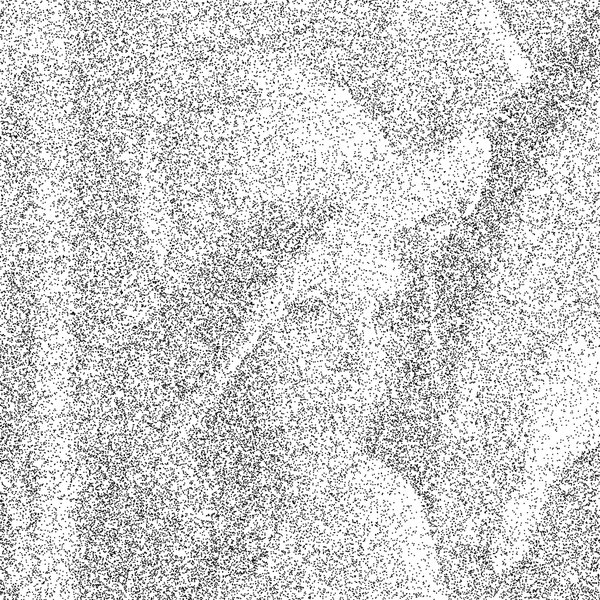
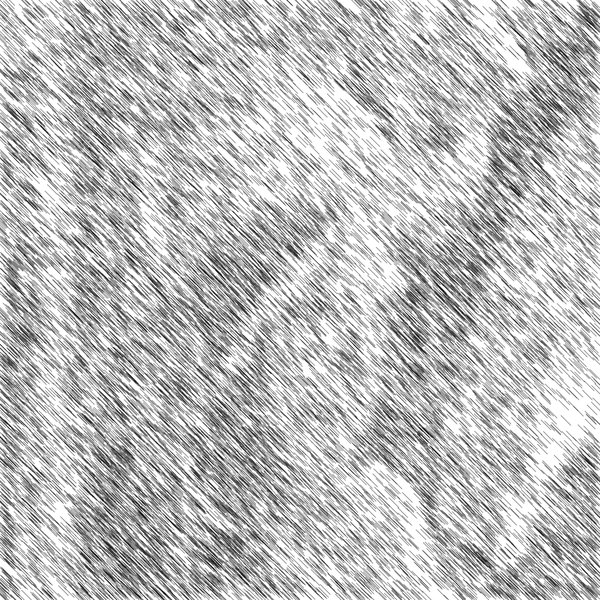

# Chance

<!-- nav -->
[← Halftone](04-halftone.md) · [Contents](README.md) · [Direction →](06-direction.md)
<!-- /nav -->

A grid gives a mechanical look. For something that looks drawn by hand, the marks need to land in less predictable places. This page puts them down at random and still gets the photo back.

## Rain on sticky paper

<!-- code: code/05_scatter.py -->
```python
import math
import random

import cairo
import numpy as np
from PIL import Image

SCALE = 2  # the drawing is this many times the size of the photo

photo = Image.open("photo.png").convert("L")
darkness = 1 - np.asarray(photo) / 255
height, width = darkness.shape

surface = cairo.ImageSurface(cairo.FORMAT_ARGB32, width * SCALE, height * SCALE)
context = cairo.Context(surface)
context.scale(SCALE, SCALE)

context.set_source_rgb(1.0, 1.0, 1.0)
context.paint()

random.seed(1)
context.set_source_rgb(0.0, 0.0, 0.0)
for _ in range(width * height // 2):
    x = random.random() * width
    y = random.random() * height
    # Dark places keep most of the dots that land on them, light places few.
    if random.random() < darkness[int(y), int(x)]:
        context.arc(x, y, 0.5, 0, math.tau)
        context.fill()

surface.write_to_png("scatter.png")
```

| The photo | Scattered dots |
| --- | --- |
|  |  |

`random.random()` returns a different number every time it is called, somewhere from 0 up to (but not including) 1. Multiplying by the width gives a random position across the photo.

The script picks a place at random, then decides whether to draw there:

```python
if random.random() < darkness[int(y), int(x)]:
```

Picture rain falling evenly over a sheet of paper, where the paper is **stickier in the dark places**. Where the darkness is 0.9, nine drops in ten stick. Where it is 0.1, one in ten does. No single drop knows anything about the picture, but together they draw it.

That one `if` is the whole idea. A fresh random number is below 0.9 nine times out of ten, so comparing a random number with the darkness keeps the right share of drops.

<details>
<summary>Why <code>int(y)</code> and <code>int(x)</code>?</summary>

The random position is a number like 203.71, but an array has no cell 203.71. `int` chops off the fraction to give the cell the position falls in. The dot itself is still drawn at the exact position, fractions and all. Cairo is happy to draw between pixels.

</details>

<details>
<summary>Why does the loop variable have the name <code>_</code>?</summary>

It is a convention for "I need to repeat this, but I do not care which turn I am on". The loop body never uses the number.

</details>

## The same luck every time

Delete the `random.seed(1)` line and run the script twice. The two pictures are different, dot for dot.

Random numbers from a computer are not really random. They come from a fixed, very long list that only looks shuffled, and the [seed](09-glossary.md#seed "The starting point for a run of random numbers. The same seed gives the same numbers in the same order, and so the same picture.") says **where in the list to start reading**. The same seed gives the same numbers in the same order, so the same picture. Without a seed, Python picks a different starting place on every run.

This matters when a picture comes out well and you want it again, or when you change one setting and want to see only what that setting did. Python's [`random` module documentation](https://docs.python.org/3/library/random.html) has the details.

## From dots to strokes

A pen leaves lines, not dots. This script keeps the sticky-paper rule and changes the mark to a short line, always at the same angle.

<!-- code: code/05_strokes.py -->
```python
import math
import random

import cairo
import numpy as np
from PIL import Image

SCALE = 2  # the drawing is this many times the size of the photo
LENGTH = 12  # length of each stroke, in photo pixels
ANGLE = 45  # direction of every stroke, in degrees

photo = Image.open("photo.png").convert("L")
darkness = 1 - np.asarray(photo) / 255
height, width = darkness.shape

surface = cairo.ImageSurface(cairo.FORMAT_ARGB32, width * SCALE, height * SCALE)
context = cairo.Context(surface)
context.scale(SCALE, SCALE)

context.set_source_rgb(1.0, 1.0, 1.0)
context.paint()

# How far a stroke reaches from its middle, sideways and downwards.
reach_x = math.cos(math.radians(ANGLE)) * LENGTH / 2
reach_y = math.sin(math.radians(ANGLE)) * LENGTH / 2

random.seed(1)
context.set_source_rgba(0.0, 0.0, 0.0, 0.7)
context.set_line_width(0.4)
context.set_line_cap(cairo.LINE_CAP_ROUND)
for _ in range(width * height // 6):
    x = random.random() * width
    y = random.random() * height
    if random.random() < darkness[int(y), int(x)]:
        context.move_to(x - reach_x, y - reach_y)
        context.line_to(x + reach_x, y + reach_y)
        context.stroke()

surface.write_to_png("strokes.png")
```



Each stroke is centred on its random spot. It starts half a stroke back from the spot and ends half a stroke past it. `reach_x` and `reach_y` are that half stroke, split into its sideways and downwards parts. (Page 6 explains the `cos` and `sin`.)

Two settings from page 2 do a lot of work here:

- **Alpha of 0.7.** Each stroke is slightly see-through, so where strokes cross, the paper gets darker. Dark areas collect more strokes and more crossings.
- **A line width of 0.4.** The magnifying glass doubles it, so the pen is 0.8 of a pixel wide on the paper. Thin lines keep the picture light and let single strokes show.

Shading with parallel lines like this is called [hatching](09-glossary.md#hatching "Shading with many roughly parallel pen strokes, closer together or more numerous where the drawing is darker."), and artists have used it for centuries. But notice what is wrong with the picture. Every stroke runs the same way, whatever it is drawing. A person shading with a pen would turn the strokes to follow the brim of the hat or the edge of the shoulder.

That is what the next two pages add.

## Try it

- Change the seed to 2 and compare the pictures closely.
- In the scatter script, change the number of tries from `width * height // 2` to `width * height * 2`. Then try `// 20`.
- Make the dots red.
- In the strokes script, set `ANGLE` to 0, then 90.
- Give each stroke its own random angle: move the `reach_x` and `reach_y` lines inside the loop, and use `random.random() * 360` for the angle. The picture survives. Why?

<!-- nav -->
[← Halftone](04-halftone.md) · [Contents](README.md) · [Direction →](06-direction.md)
<!-- /nav -->
