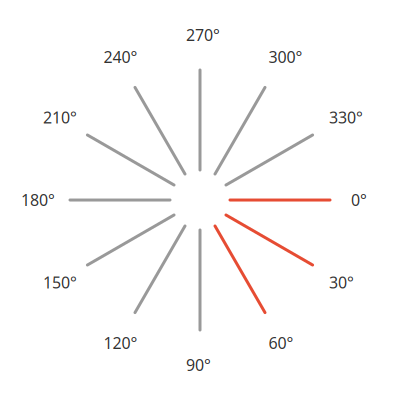
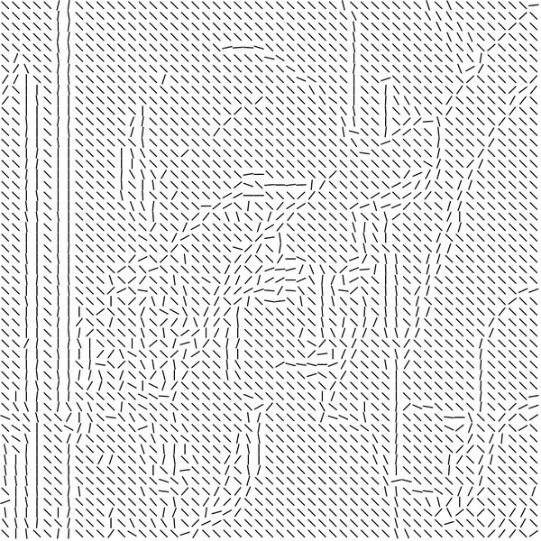

# Direction

<!-- nav -->
[← Chance](05-chance.md) · [Contents](README.md) · [Hatch →](07-hatch.md)
<!-- /nav -->

To make strokes follow the shapes in a photo, the code needs to know which way those shapes run at every pixel. This page is about angles, and about getting them out of a photo. It has the most maths in the tutorial, and it all comes down to two functions.

## An angle is a direction

<!-- code: code/06_compass.py -->
```python
import math

import cairo

surface = cairo.ImageSurface(cairo.FORMAT_ARGB32, 400, 400)
context = cairo.Context(surface)

context.set_source_rgb(1.0, 1.0, 1.0)
context.paint()

context.set_line_width(3)
context.set_line_cap(cairo.LINE_CAP_ROUND)
context.set_font_size(16)
for degrees in range(0, 360, 30):
    angle = math.radians(degrees)
    # One step in this direction: cos gives the sideways part, sin the downwards part.
    step_x, step_y = math.cos(angle), math.sin(angle)

    # The first three lines are red, to show which way the angles turn.
    if degrees <= 60:
        context.set_source_rgb(0.9, 0.3, 0.2)
    else:
        context.set_source_rgb(0.6, 0.6, 0.6)
    context.move_to(200 + step_x * 30, 200 + step_y * 30)
    context.line_to(200 + step_x * 130, 200 + step_y * 130)
    context.stroke()

    context.set_source_rgb(0.2, 0.2, 0.2)
    context.move_to(200 + step_x * 165 - 14, 200 + step_y * 165 + 6)
    context.show_text(f"{degrees}°")

surface.write_to_png("compass.png")
```



To draw a line at an angle you need to know how far it goes across and how far down. That is what `cos` and `sin` are for:

- `math.cos(angle)` is how far **across** one step in that direction takes you.
- `math.sin(angle)` is how far **down** it takes you.

At 0 degrees a step is all across and none down, so cos is 1 and sin is 0. At 90 degrees it is the other way round. In between, the step is shared out between the two, and it always has a length of exactly 1. Multiply both by 130 and you have a line 130 pixels long.

This is where `along_x` and `along_y` on page 4, and `reach_x` and `reach_y` on page 5, came from.

Two things to notice in the picture:

- **Angles turn clockwise.** In a maths book 90 degrees points up. Here it points down, because y counts downwards (page 2).
- **0 degrees points right**, not up as on a compass.

<details>
<summary>Why <code>math.radians</code>?</summary>

Python's maths functions do not measure angles in degrees. They use [radians](09-glossary.md#radian "A unit for angles in which a full turn is 2π (about 6.28) instead of 360 degrees. Python's maths functions use it."), where a full turn is 2π (about 6.28, and available as `math.tau`) instead of 360. `math.radians(90)` converts degrees to radians. Most people think in degrees and convert at the last moment, as these scripts do.

</details>

<details>
<summary>What is <code>show_text</code>?</summary>

It writes text at the hand's current position, in the current colour. It is fine for labels like these. Cairo's own documentation calls it a "toy" because it cannot do proper layout; see the [pycairo text reference](https://pycairo.readthedocs.io/en/latest/reference/context.html#cairo.Context.show_text).

</details>

## Brightness as a landscape

Now for the photo. Imagine it as a landscape seen from above, where **brightness is height**: white areas are hilltops and dark areas are valleys. The edge of a dark shape against a light one is a steep hillside.

A walker's map shows the shape of real land with [contour lines](09-glossary.md#contour "A line joining places of equal brightness, like the height lines on a walker's map. Strokes that follow contours show the form of what they draw."), which join places of equal height. Contour lines wrap around hills and run along the sides of valleys. They are exactly the lines a pen should follow to show the form of something.

So the question "which way should the stroke go here?" becomes "which way does the contour line run here?" That takes two steps.

**Step 1: find uphill.** NumPy can measure the slope at every pixel at once:

```python
down, across = np.gradient(smooth)
```

This is the [gradient](09-glossary.md#gradient "The direction in which a photo gets brighter fastest at a given pixel, and how fast. On a landscape where brightness is height, it points uphill."). It gives two arrays the same shape as the photo. `across` says how fast the brightness rises as you step right from each pixel, and `down` says how fast it rises as you step down. (Rows first, as always, so `down` comes first.) Together they point uphill.

**Step 2: turn a quarter turn.** A contour line runs **across** the slope, not up it. That is a quarter turn, 90 degrees, away from uphill.

```python
uphill = np.arctan2(down, across)
contour = uphill + math.pi / 2
```

`arctan2` is `cos` and `sin` in reverse. They turn an angle into an across-and-down step; `arctan2` turns an across-and-down step back into an angle. Note that it takes the down part first. `math.pi / 2` is a quarter turn in radians.

## Two problems, two fixes

**Noise.** A photo is never perfectly smooth. Neighbouring pixels differ a little at random, and to the gradient every tiny difference is a hillside. The fix is to [blur](09-glossary.md#blur "Smoothing a photo by mixing each pixel with its neighbours, so that small details and noise fade and large shapes remain.") the photo first, which smooths away the small bumps and leaves the big shapes:

```python
smooth = np.asarray(photo.filter(ImageFilter.GaussianBlur(3))) / 255
```

The 3 is how far the blur reaches. A larger number gives calmer, broader curves and loses small details.

**Flat ground.** In an evenly lit area there is no slope, so there is no contour to follow, and the calculated angle is meaningless. The fix is to measure how steep the slope is and fall back to a fixed angle wherever it is nearly flat:

```python
steepness = np.hypot(across, down)
angle = np.where(steepness > FLAT, contour, math.radians(45))
```

`np.hypot` gives the length of each across-and-down step, which is the steepness. `np.where` is an `if` for whole arrays: for every pixel, take the contour angle where the test is true and 45 degrees where it is not.

## Seeing the directions

An array of angles is hard to imagine, so draw it. This script puts a short needle at every tenth pixel, pointing along the angle found there.

<!-- code: code/06_field.py -->
```python
import math

import cairo
import numpy as np
from PIL import Image, ImageFilter

SCALE = 2  # the drawing is this many times the size of the photo
SPACING = 10  # distance between needles, in photo pixels
FLAT = 0.01  # slopes gentler than this count as flat

photo = Image.open("photo.png").convert("L")
height, width = photo.height, photo.width

# Blur first, so that single noisy pixels do not send the needles spinning.
smooth = np.asarray(photo.filter(ImageFilter.GaussianBlur(3))) / 255
# How fast the brightness changes at each pixel, going down and going across.
down, across = np.gradient(smooth)
steepness = np.hypot(across, down)
uphill = np.arctan2(down, across)
# Contours run across the slope: a quarter turn from uphill.
contour = uphill + math.pi / 2
# Where the photo is flat there is no contour, so fall back to 45 degrees.
angle = np.where(steepness > FLAT, contour, math.radians(45))

surface = cairo.ImageSurface(cairo.FORMAT_ARGB32, width * SCALE, height * SCALE)
context = cairo.Context(surface)
context.scale(SCALE, SCALE)

context.set_source_rgb(1.0, 1.0, 1.0)
context.paint()

context.set_source_rgb(0.0, 0.0, 0.0)
context.set_line_width(1.0)
context.set_line_cap(cairo.LINE_CAP_ROUND)
reach = SPACING * 0.45
for y in range(SPACING // 2, height, SPACING):
    for x in range(SPACING // 2, width, SPACING):
        step_x, step_y = math.cos(angle[y, x]), math.sin(angle[y, x])
        context.move_to(x - step_x * reach, y - step_y * reach)
        context.line_to(x + step_x * reach, y + step_y * reach)
        context.stroke()

surface.write_to_png("field.png")
```

| The photo | The directions |
| --- | --- |
|  |  |

It looks like iron filings around a magnet. Along every edge in the photo the needles line up with it. Everywhere else they sit at 45 degrees. An arrangement like this, with a direction at every point, is called a [flow field](09-glossary.md#flow-field "A direction for every point of a picture, like a map of wind or the pattern of iron filings around a magnet.").

Drawing your data like this is worth doing whenever you are unsure what an array holds. It is how the two problems above were found.

<details>
<summary>The needles along an edge sometimes point opposite ways. Does that matter?</summary>

Not for needles: a line drawn at 30 degrees and one drawn at 210 degrees are the same line. It will matter on the next page, when a stroke follows the angles step by step and must not double back on itself. The fix is there.

</details>

## Try it

- In the compass script, draw 36 lines instead of 12.
- Change the blur from 3 to 1, then to 10, and watch the needles.
- Change `FLAT` to 0, so that nothing counts as flat. The needles in the plain areas now point every which way: that is the noise.
- Remove the quarter turn (`contour = uphill`). The needles now point across the edges instead of along them.

<!-- nav -->
[← Chance](05-chance.md) · [Contents](README.md) · [Hatch →](07-hatch.md)
<!-- /nav -->
