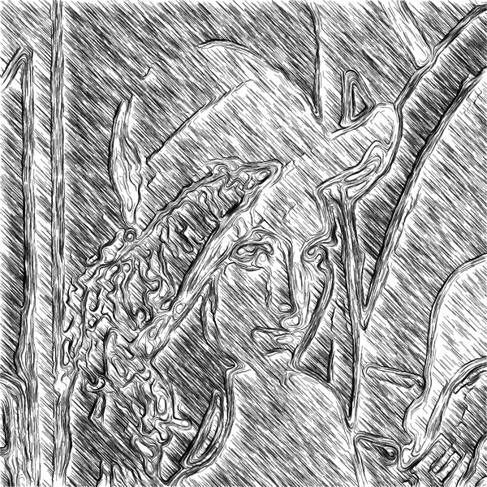

# Hatch

<!-- nav -->
[← Direction](06-direction.md) · [Contents](README.md) · [How it fits together →](08-how-it-fits-together.md)
<!-- /nav -->

Everything is ready. Page 5 put strokes in the right places. Page 6 found the right direction at every pixel. This page joins them: each stroke starts at a random spot and then **follows the directions**, curving with the shapes in the photo.

| The photo | Hatched |
| --- | --- |
|  |  |

The script is longer than the others, so it is split into three functions. Each is shown on its own below, and the whole file is at the end of the page.

## Loading

<!-- code: code/07_hatch.py : load -->
```python
def load(path):
    """Return how dark the photo is at each pixel, and which way a stroke should go there."""
    photo = Image.open(path).convert("L")
    darkness = 1 - np.asarray(photo) / 255

    smooth = np.asarray(photo.filter(ImageFilter.GaussianBlur(3))) / 255
    down, across = np.gradient(smooth)
    contour = np.arctan2(down, across) + math.pi / 2
    angle = np.where(np.hypot(across, down) > FLAT, contour, math.radians(45))
    return darkness, angle
```

Nothing here is new. The first two lines are the darkness from page 4, and the rest is the flow field from page 6, squeezed into four lines. The function returns both arrays.

## Tracing one stroke

This is the new part. A stroke on page 5 was one straight line. Now it is a walk.

<!-- code: code/07_hatch.py : trace -->
```python
def trace(x, y, darkness, angle, ink):
    """Walk from (x, y) along the angles for as long as the photo is darker than ``ink``."""
    height, width = darkness.shape
    points = [(x, y)]
    last_x, last_y = 0.0, 0.0
    for _ in range(LENGTH):
        direction = angle[int(y), int(x)]
        step_x, step_y = math.cos(direction), math.sin(direction)
        # A contour runs both ways. Keep going the way we were already heading.
        if step_x * last_x + step_y * last_y < 0:
            step_x, step_y = -step_x, -step_y
        x, y = x + step_x, y + step_y
        if not (0 <= x < width and 0 <= y < height):
            break
        if darkness[int(y), int(x)] < ink:
            break
        points.append((x, y))
        last_x, last_y = step_x, step_y
    return points
```

Think of a marble dropped on the landscape from page 6, except that it rolls **along the contour lines** instead of downhill. On every turn of the loop:

1. Look up the angle where the marble is now.
2. Turn the angle into a step with `cos` and `sin`.
3. Take the step.
4. Remember the new position in `points`.

Each step is one pixel long, and the angle is looked up afresh every time. So if the directions curve, the walk curves with them. After `LENGTH` steps the function hands back the list of positions it visited.

Three checks keep the walk sensible.

**Do not double back.** A contour line can be followed in either direction, and the flow field does not say which. Two neighbouring pixels can give angles that are half a turn apart, and a walk that obeyed both would take a step forward and then a step back. So the function remembers its last step and compares each new one against it:

```python
if step_x * last_x + step_y * last_y < 0:
    step_x, step_y = -step_x, -step_y
```

That sum is negative exactly when the two steps point in roughly opposite directions. If they do, the new step is turned around.

**Stop at the edge.** If a step leaves the photo, `break` ends the walk.

**Stop where it gets light.** This is the last check, and the next section explains it.

<details>
<summary>Why does that sum detect opposite directions?</summary>

It is called the [dot product](https://en.wikipedia.org/wiki/Dot_product) of the two steps. For two steps of length 1 it equals the cosine of the angle between them: 1 if they point the same way, 0 if they are at right angles, and −1 if they are opposite. So it is negative whenever the steps are more than a quarter turn apart.

</details>

<details>
<summary>Why are <code>last_x</code> and <code>last_y</code> zero to start with?</summary>

On the first step there is no previous step to compare with. With both set to zero the sum is zero, which is not less than zero, so the first step is never turned around. The walk sets off whichever way the angle happens to point.

</details>

## Ink levels

On page 5 a random number decided whether a stroke was **drawn**. Here the same number is kept and used again:

```python
ink = random.random()
if darkness[int(y), int(x)] > ink:
```

Call it the stroke's ink level. As before, the stroke is only started if its spot is darker than the ink level. The new part is inside `trace`: the walk also stops as soon as it reaches a pixel that is **lighter** than the ink level.

So a stroke with an ink level of 0.2 is drawn almost anywhere and wanders freely. A stroke with an ink level of 0.8 can only exist inside the darkest shadows, and stops dead at their edges.

This does two jobs. Strokes no longer leak out of dark shapes into light ones, so edges stay crisp. And the share of strokes allowed to cross any pixel still matches how dark that pixel is, so the shading stays right.

## Putting it together

<!-- code: code/07_hatch.py : main -->
```python
def main():
    random.seed(SEED)
    darkness, angle = load("photo.png")
    height, width = darkness.shape

    surface = cairo.ImageSurface(cairo.FORMAT_ARGB32, width * SCALE, height * SCALE)
    context = cairo.Context(surface)
    context.scale(SCALE, SCALE)

    context.set_source_rgb(1.0, 1.0, 1.0)
    context.paint()

    context.set_source_rgba(0.0, 0.0, 0.0, 0.8)
    context.set_line_width(0.4)
    context.set_line_cap(cairo.LINE_CAP_ROUND)
    context.set_line_join(cairo.LINE_JOIN_ROUND)
    for _ in range(width * height // 5):
        x = random.random() * width
        y = random.random() * height
        # Each stroke gets its own ink level and only crosses pixels darker than that.
        ink = random.random()
        if darkness[int(y), int(x)] > ink:
            for point_x, point_y in trace(x, y, darkness, angle, ink):
                context.line_to(point_x, point_y)
            context.stroke()

    surface.write_to_png("hatch.png")
```

`main` is the strokes script from page 5 with the straight line swapped for a traced one. The inner loop feeds the points to `line_to` one by one, and `stroke` inks the whole wiggly line at once.

<details>
<summary>The path starts with <code>line_to</code>, not <code>move_to</code>. Is that allowed?</summary>

Yes. When there is no sketch yet, cairo treats the first `line_to` as a `move_to`: there is nowhere to draw a line from, so it just puts the pencil down. It saves handling the first point separately.

</details>

<details>
<summary>What is <code>if __name__ == "__main__":</code> for?</summary>

It means "only do this when the file is run as a script". If another file imports this one to reuse `trace`, nothing is drawn. Python's documentation [explains the idiom](https://docs.python.org/3/library/__main__.html). You can leave it out and just call `main()`.

</details>

<details>
<summary>Show the whole script</summary>

<!-- code: code/07_hatch.py -->
```python
"""Hatch a photo: short pen strokes that follow its contours."""

import math
import random

import cairo
import numpy as np
from PIL import Image, ImageFilter

SCALE = 2  # the drawing is this many times the size of the photo
LENGTH = 16  # longest stroke, in photo pixels
FLAT = 0.01  # slopes gentler than this count as flat
SEED = 1


def load(path):
    """Return how dark the photo is at each pixel, and which way a stroke should go there."""
    photo = Image.open(path).convert("L")
    darkness = 1 - np.asarray(photo) / 255

    smooth = np.asarray(photo.filter(ImageFilter.GaussianBlur(3))) / 255
    down, across = np.gradient(smooth)
    contour = np.arctan2(down, across) + math.pi / 2
    angle = np.where(np.hypot(across, down) > FLAT, contour, math.radians(45))
    return darkness, angle


def trace(x, y, darkness, angle, ink):
    """Walk from (x, y) along the angles for as long as the photo is darker than ``ink``."""
    height, width = darkness.shape
    points = [(x, y)]
    last_x, last_y = 0.0, 0.0
    for _ in range(LENGTH):
        direction = angle[int(y), int(x)]
        step_x, step_y = math.cos(direction), math.sin(direction)
        # A contour runs both ways. Keep going the way we were already heading.
        if step_x * last_x + step_y * last_y < 0:
            step_x, step_y = -step_x, -step_y
        x, y = x + step_x, y + step_y
        if not (0 <= x < width and 0 <= y < height):
            break
        if darkness[int(y), int(x)] < ink:
            break
        points.append((x, y))
        last_x, last_y = step_x, step_y
    return points


def main():
    random.seed(SEED)
    darkness, angle = load("photo.png")
    height, width = darkness.shape

    surface = cairo.ImageSurface(cairo.FORMAT_ARGB32, width * SCALE, height * SCALE)
    context = cairo.Context(surface)
    context.scale(SCALE, SCALE)

    context.set_source_rgb(1.0, 1.0, 1.0)
    context.paint()

    context.set_source_rgba(0.0, 0.0, 0.0, 0.8)
    context.set_line_width(0.4)
    context.set_line_cap(cairo.LINE_CAP_ROUND)
    context.set_line_join(cairo.LINE_JOIN_ROUND)
    for _ in range(width * height // 5):
        x = random.random() * width
        y = random.random() * height
        # Each stroke gets its own ink level and only crosses pixels darker than that.
        ink = random.random()
        if darkness[int(y), int(x)] > ink:
            for point_x, point_y in trace(x, y, darkness, angle, ink):
                context.line_to(point_x, point_y)
            context.stroke()

    surface.write_to_png("hatch.png")


if __name__ == "__main__":
    main()
```

</details>

## The real thing

The project's own `hatch` effect is in [`src/effekt/hatch.py`](../../src/effekt/hatch.py). It is the same design, and you will recognise `trace` and the ink level. The differences:

- **Strokes grow both ways.** It walks forwards and backwards from the starting spot, so the spot ends up in the middle of the stroke instead of at one end.
- **Better directions.** Instead of taking the gradient's angle directly, it averages the directions around each pixel in a way that copes with opposite angles. The method is called a [structure tensor](https://en.wikipedia.org/wiki/Structure_tensor). It also blends smoothly into the fallback angle instead of switching.
- **Settings.** Length, density, pen width and the rest can be set from the command line. The next page shows how.

The [examples page](../examples.md#hatch) shows what the settings do.

## Try it

- Change `LENGTH` to 4, then to 60.
- Remove the "stop where it gets light" check from `trace` and look at the edges of the dark shapes.
- Remove the "do not double back" check. Some strokes shrink to blobs.
- Draw in colour: load the colour array as on page 3, and set the colour of each stroke from the pixel where it starts.
- Change the fallback angle from 45, or give flat areas a random angle.

<!-- nav -->
[← Direction](06-direction.md) · [Contents](README.md) · [How it fits together →](08-how-it-fits-together.md)
<!-- /nav -->
