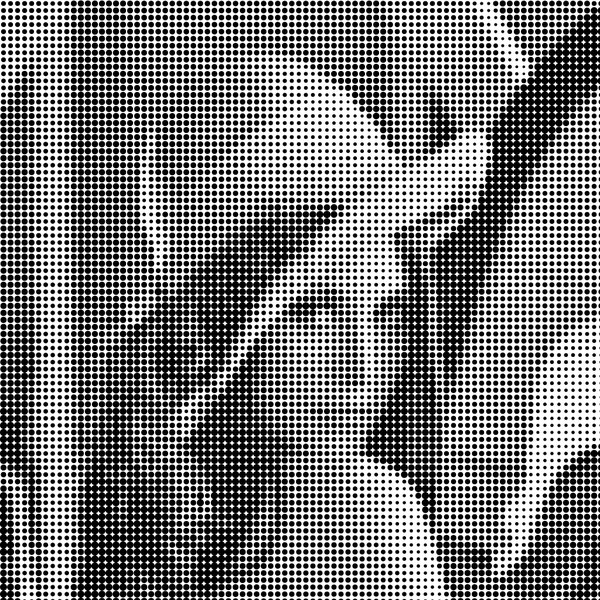
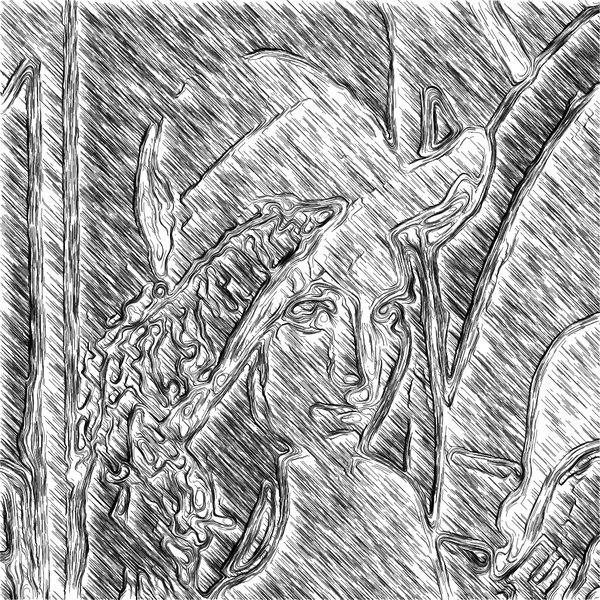

# Drawing pictures with Python: a tutorial

This tutorial shows how the pictures in this project are made, starting from an empty file. By the end you will have written two effects yourself: a newspaper-style halftone and a pen-and-ink hatching.

| The photo | Halftone (page 4) | Hatching (page 7) |
| --- | --- | --- |
|  |  |  |

It is written for people who know some Python (variables, loops, functions, `import`) and have never drawn anything with it. You do not need to know [cairo](https://www.cairographics.org/), [Pillow](https://pillow.readthedocs.io/en/stable/) or [NumPy](https://numpy.org/doc/stable/user/absolute_beginners.html); each is introduced when it is first needed.

## The pages

1. [Your first picture](01-first-picture.md): install the libraries and draw a circle.
2. [Drawing](02-drawing.md): positions, shapes, outlines and see-through colour.
3. [Reading a photo](03-reading-a-photo.md): turn a photo into numbers you can look up.
4. [Halftone](04-halftone.md): redraw the photo as dots on a grid.
5. [Chance](05-chance.md): use random numbers to scatter dots and strokes.
6. [Direction](06-direction.md): find which way the shapes in a photo run.
7. [Hatch](07-hatch.md): draw strokes that follow those shapes.
8. [How it fits together](08-how-it-fits-together.md): how this project turns scripts like yours into a tool.
9. [Glossary and further reading](09-glossary.md): every term in one place.

## How to read it

- **Go in order.** Each page uses what the one before it explained.
- **Type the code and run it.** Every page ends with things to change, and changing a number to see what happens teaches more than reading does.
- **Hover over a linked term** such as [surface](09-glossary.md#surface "The sheet of paper that cairo draws on. An image surface is a grid of pixels held in memory, which can be saved as a PNG file.") to see a one-line definition. Clicking it opens the full entry in the glossary.
- **Open the folded sections** when you want to know why something is the way it is. They look like this:

<details>
<summary>What is in a folded section?</summary>

Background, the reasoning behind a choice, or a detail you can skip on a first read. Nothing later depends on them.

</details>

## What you need

- Python 3.10 or newer.
- The three libraries, which page 1 installs.
- A photo saved as `photo.png` in the folder you work in. Any photo will do. Smaller ones, around 500 pixels wide, draw fastest.

## The code

Every script in the tutorial is a real file in [`code/`](code/), and every picture was drawn by running it. To run them from a checkout of this project instead of typing them out:

```sh
cd docs/tutorial/code
cp ../../../test-images/lena-test.png photo.png
uv run python 01_circle.py
```

If you change a script or a page, `uv run python docs/make_tutorial.py` reruns every script and copies the code back into the pages.
